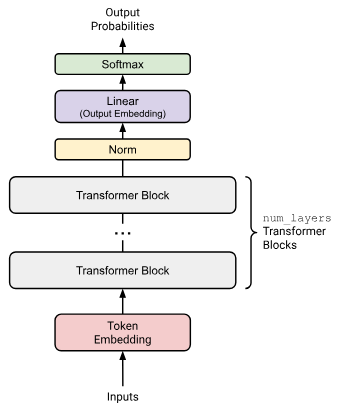
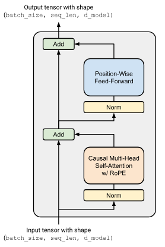
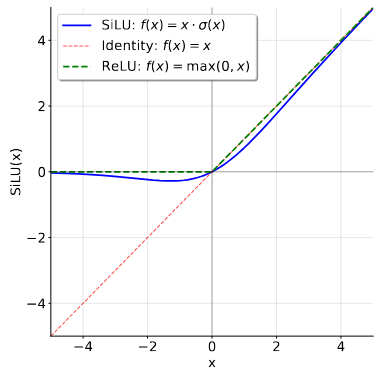

# CS336 作业 1（基础）：构建 Transformer 语言模型

版本 26.0.3  
CS336 教学团队  
2026 年春季

## 1 作业概述

本次作业中，你将从零构建训练标准 Transformer 语言模型（LM）所需的全部组件，并训练一些模型。

### 需要实现的内容

1. 字节对编码（BPE）分词器（第 2 节）。
2. Transformer 语言模型（LM）（第 3 节）。
3. 交叉熵损失函数和 AdamW 优化器（第 4 节）。
4. 训练循环，支持模型状态和优化器状态的序列化与加载（第 5 节）。

### 需要运行的内容

1. 在 TinyStories 数据集上训练 BPE 分词器。
2. 使用训练好的分词器对数据集编码，将其转换为整数 ID 序列。
3. 在 TinyStories 数据集上训练 Transformer 语言模型。
4. 使用训练好的 Transformer 语言模型生成样本，并评估困惑度。
5. 在 OpenWebText 上训练模型，并将得到的困惑度提交到排行榜。

### 可以使用的内容

我们要求你从零构建每个组件。具体而言，**不得**使用 `torch.nn`、`torch.nn.functional` 或 `torch.optim` 中的任何定义，以下内容除外：

- `torch.nn.Parameter`。
- `torch.nn` 中的容器类（如 `Module`、`ModuleList`、`Sequential` 等）。[^1]
- `torch.optim.Optimizer` 基类。

可以使用 PyTorch 中的其他任何定义。如果想使用某个函数或类，但不确定是否允许，可以在 Slack 上提问。拿不准时，请考虑使用它是否违背本作业“从零实现”的理念。

### 关于 AI 工具的声明

AI 能够完全自主地解决作业中的许多部分。这使得深入理解课程材料、从中学习变得更加困难。

允许使用 AI 工具回答高层次的概念问题，或提供函数签名、库 API 等底层编程文档。但**不允许使用 AI 工具实现任何作业的任何部分**。这一限制既包括编程智能体（如 Cursor Agents、Codex、Claude Code），也包括 AI 自动补全（如 Cursor Tab、GitHub Copilot）。使用 AI 智能体时，请确保其使用所提供的 `AGENTS.md` 文件。使用聊天机器人时，也应将该提示词一并提供。

我们强烈建议你在完成作业时关闭 IDE 中的 AI 自动补全（如 Cursor Tab、GitHub Copilot）；非 AI 自动补全，例如自动补全函数名，则完全可以使用。往届学生指出，关闭 AI 自动补全使他们更容易深入理解课程材料。

完整 AI 政策见[此文档](https://docs.google.com/document/d/1SZAlExB1qAc9izHt54gwunNpjKE6wXb8Y7yA_e-baK8/edit?tab=t.0)。

### 代码结构

作业代码及本说明文档均发布在 GitHub：

<https://github.com/stanford-cs336/assignment1-basics>

请使用 `git clone` 克隆仓库。如有更新，我们会通知你，届时可通过 `git pull` 获取最新版本。

1. `cs336_basics/*`：你在这里编写代码。注意，这里没有现成代码，你可以完全从零自由实现！
2. `adapters.py`：你的代码必须具备一组指定功能。对于每项功能（如缩放点积注意力），只需调用你自己的代码，填入对应实现（如 `run_scaled_dot_product_attention`）。注意：对 `adapters.py` 的修改不应包含实质性逻辑；它只是用于衔接的胶水代码。
3. `test_*.py`：包含所有必须通过的测试（如 `test_scaled_dot_product_attention`）。这些测试会调用 `adapters.py` 中定义的钩子函数。不要修改测试文件。

### 提交方式

提交前，运行 `make_submission.sh` 生成提交用的 zip 文件。如果有不希望放入提交压缩包的大型数据文件或检查点，请务必将这些额外文件加入脚本的排除列表。

需要向 Gradescope 提交以下文件：

- `writeup.pdf`：回答所有书面问题。请对答案进行排版。
- `code.zip`：包含你编写的全部代码。

如需提交到排行榜，请向以下仓库提交 PR：

<https://github.com/stanford-cs336/assignment1-basics-leaderboard>

详细提交说明见排行榜仓库中的 `README.md`。

### 数据集获取方式

本次作业使用两个经过预处理的数据集：TinyStories [R. Eldan 等，2023] 和 OpenWebText [A. Gokaslan 等，2019]。每个数据集都是一个大型纯文本文件。

如果你随班完成本作业，可以在计算资源指南中找到数据集下载说明。

如果你在家自学，可以使用 `README.md` 中的命令下载这些文件。

> **低资源提示：入门**
>
> 在本课程的作业说明中，我们会就如何在 GPU 资源较少或没有 GPU 的情况下完成部分作业提供建议。例如，有时会建议缩小数据集或模型规模，或说明如何在 Mac 集成 GPU 或 CPU 上运行训练代码。你会在蓝色方框中看到这些“低资源提示”（就像本框一样）。即使你是可以使用课程机器的斯坦福在校学生，这些提示也可能帮助你更快迭代、节省时间，因此建议阅读！

> **低资源提示：在 Apple Silicon 或 CPU 上完成作业 1**
>
> 使用教学团队的参考实现，在配备 36 GB 内存的 Apple M4 Max 芯片上，我们可以训练出能生成较流畅文本的语言模型：使用 Metal GPU（MPS）不到 5 分钟，使用 CPU 约 30 分钟。如果你不太理解这些术语，也不必担心！只需知道，只要你有一台较新的笔记本电脑，且实现正确、高效，就能训练一个小型语言模型，较流畅地生成简单的儿童故事。
>
> 在作业后文，我们会说明使用 CPU 或 MPS 时需要做哪些调整。

## 2 字节对编码（BPE）分词器

本作业的第一部分是训练并实现一个字节级字节对编码（BPE）分词器 [R. Sennrich 等，2016；C. Wang 等，2019]。具体而言，我们会将任意（Unicode）字符串表示为字节序列，并在该字节序列上训练 BPE 分词器。之后，我们将使用这个分词器，把文本（字符串）编码为token（整数序列），用于语言建模。

### 2.1 Unicode 标准

Unicode 是一种文本编码标准，将字符映射到整数**码点**。截至 Unicode 17.0（2025 年 9 月发布），该标准定义了 172 种文字系统中的 159,801 个字符。例如，字符“s”的码点为 115，通常记作 `U+0073`，其中 `U+` 是约定前缀，`0073` 是 115 的十六进制表示；字符“牛”的码点为 29275。在 Python 中，可以使用 `ord()` 函数将单个 Unicode 字符转换为对应整数。`chr()` 函数则将整数 Unicode 码点转换为包含对应字符的字符串。

```python
>>> ord('牛')
29275
>>> chr(29275)
'牛'
```

#### 题目（unicode1）：理解 Unicode（1 分）

**(a)** `chr(0)` 返回什么 Unicode 字符？

**交付内容：** 用一句话回答。

**(b)** 这个字符的字符串表示（`__repr__()`）与打印出来的表示有什么不同？

**交付内容：** 用一句话回答。

**(c)** 这个字符出现在文本中时会发生什么？可以在 Python 解释器中尝试以下内容，看看结果是否符合预期：

```python
>>> chr(0)
>>> print(chr(0))
>>> "this is a test" + chr(0) + "string"
>>> print("this is a test" + chr(0) + "string")
```

**交付内容：** 用一句话回答。

### 2.2 Unicode 编码

虽然 Unicode 标准定义了字符到码点（整数）的映射，但直接在 Unicode 码点上训练分词器并不现实，因为词表会极其庞大（约 15 万项），而且十分稀疏（许多字符很罕见）。因此，我们将使用一种 Unicode 编码，将 Unicode 字符转换为字节序列。Unicode 标准本身定义了三种编码：UTF-8、UTF-16 和 UTF-32，其中 UTF-8 是互联网的主流编码，超过 98% 的网页使用它。

要将 Unicode 字符串编码为 UTF-8，可以使用 Python 的 `encode()` 函数。要查看 Python `bytes` 对象的底层字节值，可以遍历它，例如调用 `list()`。最后，可以使用 `decode()` 函数将 UTF-8 字节串解码为 Unicode 字符串。

```python
>>> test_string = "hello! こんにちは!"
>>> utf8_encoded = test_string.encode("utf-8")
>>> print(utf8_encoded)
b'hello! \xe3\x81\x93\xe3\x82\x93\xe3\x81\xab\xe3\x81\xa1\xe3\x81\xaf!'
>>> print(type(utf8_encoded))
<class 'bytes'>
>>> # 获取编码后字符串的字节值（0 到 255 的整数）。
>>> list(utf8_encoded)
[104, 101, 108, 108, 111, 33, 32, 227, 129, 147, 227, 130, 147, 227, 129, 171, 227, 129, 161, 227, 129, 175, 33]
>>> # 一个字节不一定对应一个 Unicode 字符！
>>> print(len(test_string))
13
>>> print(len(utf8_encoded))
23
>>> print(utf8_encoded.decode("utf-8"))
hello! こんにちは!
```

将 Unicode 码点转换为字节序列（例如通过 UTF-8 编码），实质上是把码点序列（具有 159,801 个有效取值的 21 位整数）转换为字节值序列（0 到 255 范围内的整数）。只有 256 项的字节词表要容易处理得多。使用字节级分词时，无需担心词表外token，因为**任何**输入文本都可以表示为 0 到 255 的整数序列。

#### 题目（unicode2）：Unicode 编码（3 分）

**(a)** 相比 UTF-16 或 UTF-32，选择在 UTF-8 编码后的字节上训练分词器有哪些理由？可以比较这些编码对不同输入字符串的输出。

**交付内容：** 用一至两句话回答。

**Answer**:  UTF-8 对 ASCII 字符只需 1 字节，而 UTF-16 和 UTF-32 分别需要 2 和 4 字节，因此 UTF-8 通常能减少英文及代码文本的初始序列长度，提高 BPE 训练效率。此外，UTF-8 兼容 ASCII 且不存在字节序问题，更适合处理多语言混合文本。

**(b)** 考虑以下试图将 UTF-8 字节串解码为 Unicode 字符串的（错误）函数。为什么这个函数不正确？请给出一个会产生错误结果的输入字节串示例。

```python
def decode_utf8_bytes_to_str_wrong(bytestring: bytes):
    return "".join([bytes([b]).decode("utf-8") for b in bytestring])

>>> decode_utf8_bytes_to_str_wrong("hello".encode("utf-8"))
'hello'
```

**交付内容：** 给出一个使 `decode_utf8_bytes_to_str_wrong` 产生错误输出的输入字节串，并用一句话说明该函数为什么不正确。

**Answer**: 
原因： UTF-8 中一个 Unicode 字符可能由多个字节组成（例如“中”需要 3 字节），但该函数逐字节独立解码，导致多字节字符无法正确解码。

正确写法：
```python
def decode_utf8_bytes_to_str(bytestring: bytes):
    return bytestring.decode("utf-8")
```

**(c)** 给出一个无法解码为任何 Unicode 字符的双字节序列。

**交付内容：** 给出一个示例，并用一句话解释。

**Answer**:
示例：
```python
b'\xff\xff'
```
解释： 0xFF 不是 UTF-8 允许的有效字节，因此 b'\xff\xff' 不是合法的 UTF-8 编码序列，无法通过 UTF-8 解码为 Unicode 字符串。

### 2.3 子词分词

虽然字节级分词可以缓解词级分词器面临的词表外问题，但将文本切分为字节会产生极长的输入序列，从而减慢模型训练。一个含 10 个单词的句子，在词级语言模型中可能只有 10 个token，在字符级模型中却可能有 50 个甚至更多token，具体取决于单词长度。处理这些更长的序列，要求模型每一步进行更多计算。此外，较长的输入序列会在数据中产生长程依赖，因此在字节序列上进行语言建模较为困难。

子词分词介于词级分词和字节级分词之间。注意，字节级分词器的词表包含 256 项（字节值为 0 到 255）。子词分词器以更大的词表为代价，换取对输入字节序列更好的压缩。例如，如果字节序列 `b'the'` 经常出现在原始训练文本中，为它分配一个词表条目，就能将这个包含 3 个token的序列缩减为单个token。

如何选择加入词表的子词单元？R. Sennrich 等 [3] 提出使用**字节对编码**（BPE；P. Gage [5]），这是一种压缩算法，迭代地将频率最高的字节对替换（“合并”）为一个尚未使用的新索引。注意，该算法向词表中添加子词token，以最大限度地压缩输入序列：如果某个单词在输入文本中出现得足够频繁，它就会表示为一个子词单元。

通过 BPE 构建词表的子词分词器通常称为 BPE 分词器。本作业将实现一个字节级 BPE 分词器，词表项是字节或合并后的字节序列，从而兼顾词表外处理能力和可控的输入序列长度。构建 BPE 分词器词表的过程称为“训练”BPE 分词器。

### 2.4 BPE 分词器训练

BPE 分词器的训练过程包括三个主要步骤。

#### 词表初始化

分词器词表是字节串token到整数 ID 的一一映射。由于我们训练的是字节级 BPE 分词器，初始词表就是所有字节的集合。字节有 256 种可能取值，因此初始词表大小为 256。

#### 预分词

有了词表，原则上就可以统计文本中各字节相邻出现的频率，并从频率最高的字节对开始合并。但这种做法计算代价很高，因为每合并一次都需要完整遍历语料库。此外，直接在整个语料库中合并字节，可能产生仅标点不同的token（如 `dog!` 与 `dog.`）。尽管它们很可能在语义上高度相似（因为仅标点不同），却会获得完全不同的token ID。

为避免这一问题，我们对语料库进行**预分词**。可以将其理解为对语料库进行粗粒度分词，以便统计字符对出现的频率。例如，单词 `'text'` 可能是出现了 10 次的一个预token。此时，统计字符 ‘t’ 和 ‘e’ 相邻出现的频率时，只需看到单词 ‘text’ 中 ‘t’ 和 ‘e’ 相邻，就能将计数增加 10，而无需遍历整个语料库。由于我们训练的是字节级 BPE 模型，每个预token都表示为 UTF-8 字节序列。

R. Sennrich 等 [3] 的原始 BPE 实现仅按空格进行预分词（即 `s.split(" ")`）。基于 SentencePiece 的分词器中仍能见到这种方法，例如 Llama 1 和 2 的分词器。

多数现代分词器采用基于正则表达式的预分词器，这种做法源自 GPT-2；见 A. Radford 等 [6]。我们将使用原始正则表达式的一种稍简洁的形式，取自：

<https://github.com/openai/tiktoken/pull/234/files>

```python
>>> PAT = r"""'(?:[sdmt]|ll|ve|re)| ?\p{L}+| ?\p{N}+| ?[^\s\p{L}\p{N}]+|\s+(?!\S)|\s+"""
```

可以交互式地使用这个预分词器切分一些文本，以更好地理解它的行为：

```python
>>> # 需要安装 `regex` 包
>>> import regex as re
>>> re.findall(PAT, "some text that i'll pre-tokenize")
['some', ' text', ' that', ' i', "'ll", ' pre', '-', 'tokenize']
```

不过，在自己的代码中，应使用 `re.finditer`，以便在构建预token到其计数的映射时，无需存储预分词得到的单词。

#### 计算 BPE 合并

将输入文本转换为预token，并将每个预token表示为 UTF-8 字节序列后，就可以计算 BPE 合并，即训练 BPE 分词器。概括而言，BPE 算法会迭代统计每种字节对的次数，并找出频率最高的一对（“A”，“B”）。随后，将这对最高频的字节（“A”，“B”）的每次出现都**合并**，即替换为新token“AB”。这个新合并的token会加入词表。因此，BPE 训练结束后的词表大小，等于初始词表大小（本作业中为 256）加上训练中执行的 BPE 合并次数。为提高 BPE 训练效率，我们不考虑跨越预token边界的字节对。[^2] 计算合并时，如字节对频率相同，应优先选择**字典序更大的字节对**，以确定性地打破平局。例如，如果（“A”，“B”）、（“A”，“C”）、（“B”，“ZZ”）和（“BA”，“A”）的频率均最高，则应合并（“BA”，“A”）：

```python
>>> max([("A", "B"), ("A", "C"), ("B", "ZZ"), ("BA", "A")])
('BA', 'A')
```

#### 特殊token

一些字符串（如 `<|endoftext|>`）常用于编码元数据，例如文档之间的边界。编码文本时，通常希望将某些字符串视为“特殊token”，永远不拆分为多个token，即始终保留为单个token。例如，序列结束字符串 `<|endoftext|>` 应始终保留为单个token（即单个整数 ID），以便知道何时停止语言模型生成。必须将这些特殊token加入词表，使其具有对应的固定token ID。

R. Sennrich 等 [3] 的算法 1 给出了一个效率较低的 BPE 分词器训练实现，基本遵循上述步骤。作为初步练习，可以先实现并测试该函数，检查自己的理解。

#### 示例（bpe_example）：BPE 训练示例

下面是根据 R. Sennrich 等 [3] 给出的一个简化示例。考虑由以下文本组成的语料库：

```text
low low low low low
lower lower widest widest widest
newest newest newest newest newest newest
```

词表中还有一个特殊token `<|endoftext|>`。

**词表**

使用特殊token `<|endoftext|>` 和 256 个字节值初始化词表。

**预分词**

为简化说明、聚焦合并过程，本例假设预分词仅按空白字符切分。预分词并计数后，得到以下频率表：

```text
{low: 5, lower: 2, widest: 3, newest: 6}
```

将其表示为 `dict[tuple[bytes, ...], int]` 很方便，例如 `{(l,o,w): 5, …}`。注意，在 Python 中，即使单个字节也是 `bytes` 对象。Python 没有表示单个字节的 `byte` 类型，就像没有表示单个字符的 `char` 类型一样。

**合并**

首先检查所有相邻字节对，并累加它们所在单词的频率，得到 `{lo: 7, ow: 7, we: 8, er: 2, wi: 3, id: 3, de: 3, es: 9, st: 9, ne: 6, ew: 6}`。`('e', 's')` 和 `('s', 't')` 并列，因此取字典序更大的 `('s', 't')`。随后合并预token，得到 `{(l,o,w): 5, (l,o,w,e,r): 2, (w,i,d,e,st): 3, (n,e,w,e,st): 6}`。

第二轮中，`(e, st)` 是最常见的字节对（计数为 9），合并后得到 `{(l,o,w): 5, (l,o,w,e,r): 2, (w,i,d,est): 3, (n,e,w,est): 6}`。继续进行，最终得到的合并序列为 `['s t', 'e st', 'o w', 'l ow', 'w est', 'n e', 'ne west', 'w i', 'wi d', 'wid est', 'low e', 'lowe r']`。

如果只进行 6 次合并，就得到 `['s t', 'e st', 'o w', 'l ow', 'w est', 'n e']`，词表元素为 `[<|endoftext|>, [...256 BYTE CHARS], st, est, ow, low, west, ne]`，其中 `...256 BYTE CHARS` 表示 256 个字节字符。

使用该词表和合并集合，单词 `newest` 会被切分为 `[ne, west]`。

### 2.5 BPE 分词器训练实验

接下来，在 TinyStories 数据集上训练一个字节级 BPE 分词器。数据集的查找和下载说明见第 1 节。开始之前，建议浏览 TinyStories 数据集，了解其中的数据内容。

#### 并行化预分词

你会发现，预分词步骤是主要瓶颈之一。可以使用内置的 `multiprocessing` 库并行化代码，加快预分词。具体而言，我们建议在并行预分词实现中将语料库分块，并确保块边界位于特殊token的开头。可以直接使用以下链接中的起始代码获取分块边界，再据此将工作分配给多个进程：

<https://github.com/stanford-cs336/assignment1-basics/blob/main/cs336_basics/pretokenization_example.py>

这种分块方式始终有效，因为我们从不希望跨文档边界合并。在本作业中，总可以按这种方式切分。无需考虑收到一个不含 `<|endoftext|>` 的超大语料库这一边界情况。

#### 预分词前移除特殊token

在使用正则表达式模式运行预分词（通过 `re.finditer`）前，应从语料库中移除所有特殊token；如果使用并行实现，则从相应分块中移除。务必**按特殊token切分**，确保合并不会跨越它们所划定的文本边界。例如，对于 `[Doc 1]<|endoftext|>[Doc 2]` 这样的语料库或分块，应按特殊token `<|endoftext|>` 切分，分别对 `[Doc 1]` 和 `[Doc 2]` 预分词，使合并不会跨越文档边界。换言之，特殊token在训练中定义了不可跨越的分段边界，但其本身不应计入合并统计。可以使用 `re.split`，以 `"|".join(special_tokens)` 为分隔表达式来实现；需谨慎使用 `re.escape`，因为特殊token中可能出现 `|`。测试 `test_train_bpe_special_tokens` 会检查这一点。

#### 优化合并步骤

上述简化示例中的朴素 BPE 训练实现较慢，因为每次合并都要遍历所有字节对，寻找出现频率最高的一对。然而，每次合并后，只有与被合并字节对重叠的相邻对计数会发生变化。因此，可以为所有字节对的计数建立索引，并增量更新这些计数，来提高 BPE 训练速度，而无需显式遍历每种字节对并统计频率。这种缓存方法可以带来显著加速，不过需要说明的是，BPE 训练的合并部分在 Python 中**无法并行化**。

> **低资源提示：性能分析**
>
> 应使用 `cProfile` 或 `py-spy` 等性能分析工具找出实现中的瓶颈，并集中优化这些部分。

> **低资源提示：“缩小规模”**
>
> 建议不要一开始就在完整 TinyStories 数据集上训练分词器，而是先使用一个小的数据子集，即“调试数据集”。例如，可以改用 TinyStories 验证集训练分词器；它只有 2.2 万篇文档，而完整数据集有 212 万篇。
>
> 这体现了一种通用策略：尽可能缩小规模以加快开发，例如使用更小的数据集、更小的模型等。选择调试数据集大小或超参数配置时，需要仔细权衡：调试集应足够大，能暴露与完整配置相同的瓶颈，使优化能推广到完整配置；同时又不能太大，以免运行耗时过长。

#### 题目（train_bpe）：BPE 分词器训练（15 分）

**交付内容：** 编写一个函数，给定输入文本文件的路径，训练一个（字节级）BPE 分词器。BPE 训练函数至少应处理以下输入参数：

**输入**

| 参数 | 类型 | 说明 |
| --- | --- | --- |
| `input_path` | `str` | 包含 BPE 分词器训练数据的文本文件路径。 |
| `vocab_size` | `int` | 定义最终词表最大大小的正整数，包括初始字节词表、合并产生的词表项以及所有特殊token。 |
| `special_tokens` | `list[str]` | 要加入词表的字符串列表。训练中，将其视为不可跨越的边界，禁止跨越其所在区间合并，但计算合并统计时不包括它们。 |

BPE 训练函数应返回得到的词表和合并列表：

**输出**

| 返回值 | 类型 | 说明 |
| --- | --- | --- |
| `vocab` | `dict[int, bytes]` | 分词器词表，从 `int`（词表中的token ID）映射到 `bytes`（token字节）。 |
| `merges` | `list[tuple[bytes, bytes]]` | 训练产生的 BPE 合并列表。每项是一个 `bytes` 元组 `(<token1>, <token2>)`，表示 `<token1>` 与 `<token2>` 合并。合并项应按创建顺序排列。 |

要使用提供的测试检查 BPE 训练函数，首先需要实现测试适配器 `adapters.run_train_bpe`。随后运行 `uv run pytest tests/test_train_bpe.py`。你的实现应通过所有测试。也可以选择使用系统编程语言实现训练方法的关键部分，例如 C++（可考虑 `cppyy` 或 `nanobind`）或 Rust（使用 PyO3），不过这可能耗费较多时间。如果这样做，请注意哪些操作需要复制、哪些操作直接读取 Python 内存，并务必提供构建说明，或确保仅通过 `pyproject.toml` 即可构建。还需注意，多数正则表达式引擎不能很好地支持 GPT-2 正则表达式，即使支持，多数也过于缓慢。我们已验证 Oniguruma 速度尚可，且支持负向前瞻，但 Python 的 `regex` 包甚至可能更快。

#### 题目（train_bpe_tinystories）：在 TinyStories 上训练 BPE（2 分）

**(a)** 在 TinyStories 数据集上训练字节级 BPE 分词器，最大词表大小为 10,000。务必将 TinyStories 的特殊token `<|endoftext|>` 加入词表。将得到的词表和合并列表序列化到磁盘，以便进一步检查。训练耗时多少、占用多少内存？词表中最长的token是什么？它是否合理？

**资源要求：** ≤ 30 分钟（不使用 GPU），≤ 30 GB RAM。

**提示：** 在预分词时使用 `multiprocessing`，并利用以下两个事实，应能将 BPE 训练时间控制在 2 分钟以内：

1. `<|endoftext|>` token分隔数据文件中的文档。
2. 在应用 BPE 合并之前，会先将 `<|endoftext|>` 作为特殊情况处理。

**交付内容：** 用一至两句话回答。

**(b)** 对代码进行性能分析。分词器训练过程中，哪个部分最耗时？

**交付内容：** 用一至两句话回答。

接下来，尝试在 OpenWebText 数据集上训练字节级 BPE 分词器。与之前一样，建议先浏览数据集，以更好地理解其内容。

#### 题目（train_bpe_expts_owt）：在 OpenWebText 上训练 BPE（2 分）

**(a)** 在 OpenWebText 数据集上训练字节级 BPE 分词器，最大词表大小为 32,000。将得到的词表和合并列表序列化到磁盘，以便进一步检查。词表中最长的token是什么？它是否合理？

**资源要求：** ≤ 12 小时（不使用 GPU），≤ 100 GB RAM。

**交付内容：** 用一至两句话回答。

**(b)** 比较在 TinyStories 和 OpenWebText 上训练得到的分词器，说明其异同。

**交付内容：** 用一至两句话回答。

### 2.6 BPE 分词器：编码与解码

在上一部分中，我们实现了一个在输入文本上训练 BPE 分词器的函数，得到了分词器词表和 BPE 合并列表。现在，我们将实现一个 BPE 分词器，加载给定词表和合并列表，并用它们在文本与token ID 之间进行编码和解码。

#### 2.6.1 文本编码

使用 BPE 编码文本的过程与训练 BPE 词表相对应，主要包括以下步骤。

**步骤 1：预分词。** 首先对序列进行预分词，并将每个预token表示为 UTF-8 字节序列，与 BPE 训练时相同。我们将在每个预token内部合并这些字节，得到词表元素。每个预token独立处理，不跨预token边界合并。

**步骤 2：应用合并。** 随后，取出 BPE 训练中创建的词表元素合并序列，**按创建时的相同顺序**应用到预token上。

#### 示例（bpe_encoding）：BPE 编码示例

假设输入字符串为 `'the cat ate'`，词表为 `{0: b' ', 1: b'a', 2: b'c', 3: b'e', 4: b'h', 5: b't', 6: b'th', 7: b' c', 8: b' a', 9: b'the', 10: b' at'}`，学到的合并为 `[(b't', b'h'), (b' ', b'c'), (b' ', b'a'), (b'th', b'e'), (b' a', b't')]`。首先，预分词器将字符串切分为 `['the', ' cat', ' ate']`。然后，对每个预token应用 BPE 合并。

第一个预token `'the'` 最初表示为 `[b't', b'h', b'e']`。查看合并列表，找到第一个可应用的合并 `(b't', b'h')`，将预token转换为 `[b'th', b'e']`。随后回到合并列表，找到下一个可应用的合并 `(b'th', b'e')`，将其转换为 `[b'the']`。再次查看合并列表后，发现已无可应用于该字符串的合并，因为整个预token已经合并为单个token，因此 BPE 合并完成。对应整数序列为 `[9]`。

对其余预token重复这一过程。预token `' cat'` 应用 BPE 合并后表示为 `[b' c', b'a', b't']`，对应整数序列 `[7, 1, 5]`。最后一个预token `' ate'` 应用合并后为 `[b' at', b'e']`，对应整数序列 `[10, 3]`。因此，输入字符串最终编码为 `[9, 7, 1, 5, 10, 3]`。

**特殊token**

编码文本时，分词器应能正确处理用户定义的特殊token，这些token在构造分词器时提供。

**内存方面的考虑**

假设要对一个无法放入内存的大型文本文件进行分词。为了高效处理该文件或其他数据流，需要将其切分为可处理的块，并依次处理，使内存复杂度保持常数，而不是随文本大小线性增长。在此过程中，必须确保token不会跨越分块边界，否则分词结果将与把整个序列放入内存进行分词的朴素方法不同。

#### 2.6.2 文本解码

要将整数token ID 序列解码回原始文本，只需查找每个 ID 对应的词表条目（字节序列），将其拼接，再将字节解码为 Unicode 字符串。注意，输入 ID 不保证能映射为有效的 Unicode 字符串，因为用户可以输入任意整数 ID 序列。如果输入token ID 无法生成有效的 Unicode 字符串，应使用官方 Unicode 替换字符 `U+FFFD` 替换格式错误的字节。[^3] `bytes.decode` 的 `errors` 参数控制 Unicode 解码错误的处理方式，使用 `errors='replace'` 就会自动将格式错误的数据替换为替换标记。

#### 题目（tokenizer）：实现分词器（15 分）

**交付内容：** 实现一个 `Tokenizer` 类，给定词表和合并列表，能将文本编码为整数 ID，也能将整数 ID 解码为文本。分词器还应支持用户提供的特殊token；如果词表中尚无这些token，则将其追加到词表。建议采用以下接口：

- `def __init__(self, vocab, merges, special_tokens=None)`：根据给定词表、合并列表和可选的特殊token列表构造分词器。应接收以下参数：

  | 参数 | 类型 |
  | --- | --- |
  | `vocab` | `dict[int, bytes]` |
  | `merges` | `list[tuple[bytes, bytes]]` |
  | `special_tokens` | `list[str] \| None = None` |

- `def from_files(cls, vocab_filepath, merges_filepath, special_tokens=None)`：类方法，根据序列化后的词表和合并列表，以及可选的特殊token列表，构造并返回 `Tokenizer`。序列化格式应与 BPE 训练代码的输出一致。该方法应接收以下额外参数：

  | 参数 | 类型 |
  | --- | --- |
  | `vocab_filepath` | `str` |
  | `merges_filepath` | `str` |
  | `special_tokens` | `list[str] \| None = None` |

- `def encode(self, text: str) -> list[int]`：将输入文本编码为token ID 序列。
- `def encode_iterable(self, iterable: Iterable[str]) -> Iterator[int]`：给定一个字符串可迭代对象（如 Python 文件句柄），返回一个惰性地产生token ID 的生成器。对于无法直接加载到内存的大型文件，需要此方法来实现内存高效的分词。
- `def decode(self, ids: list[int]) -> str`：将token ID 序列解码为文本。

要使用提供的测试检查 `Tokenizer`，首先需要实现测试适配器 `adapters.get_tokenizer`。随后运行 `uv run pytest tests/test_tokenizer.py`。你的实现应通过所有测试。

### 2.7 实验

#### 题目（tokenizer_experiments）：分词器实验（4 分）

**(a)** 分别从 TinyStories 和 OpenWebText 中抽取 10 篇文档。使用此前训练好的 TinyStories 和 OpenWebText 分词器（词表大小分别为 10K 和 32K），将这些文档编码为整数 ID。每个分词器的压缩率（字节数/token数）是多少？

**交付内容：** 用一至两句话回答。

**(b)** 如果使用 TinyStories 分词器对 OpenWebText 样本分词，会发生什么？比较压缩率，和/或定性描述发生的情况。

**交付内容：** 用一至两句话回答。

**(c)** 估算分词器的吞吐量，例如以字节/秒为单位。对 Pile 数据集（825 GB 文本）分词需要多长时间？

**交付内容：** 用一至两句话回答。

**(d)** 使用 TinyStories 和 OpenWebText 分词器，将各自的训练集与开发集编码为整数token ID 序列。之后将用它们训练语言模型。建议将token ID 序列化为数据类型为 `uint16` 的 NumPy 数组。为什么 `uint16` 是合适的选择？

**交付内容：** 用一至两句话回答。

## 3 Transformer 语言模型架构

语言模型以批量整数token ID 序列为输入，即形状为 `(batch_size, sequence_length)` 的 `torch.Tensor`，返回词表上的批量归一化概率分布，即形状为 `(batch_size, sequence_length, vocab_size)` 的 PyTorch 张量。对于每个输入token，预测的分布描述其下一个词。训练语言模型时，我们使用这些下一词预测，计算实际下一词与预测下一词之间的交叉熵损失。在推理时生成文本，则使用最后一个时间步（即序列最后一项）的下一词预测分布，生成序列中的下一个token，例如选择概率最大的token，或从分布中采样；随后将生成的token加入输入序列，重复这一过程。

本部分中，你将从零构建这个 Transformer 语言模型。我们先从模型的整体描述开始，再逐步详细说明各个组件。

### 3.1 Transformer 语言模型

给定token ID 序列，Transformer 语言模型使用输入嵌入将token ID 转换为稠密向量，让嵌入后的token经过 `num_layers` 个 Transformer 块，再应用一个可学习的线性投影（“输出嵌入”或“LM 头”），产生对下一token的预测 logits。示意图见图 1。



*图 1：本作业 Transformer 语言模型的概览。图中标注：Inputs＝输入；Token Embedding＝token嵌入；Transformer Block＝Transformer 块；`num_layers` Transformer Blocks＝`num_layers` 个 Transformer 块；Norm＝归一化；Linear (Output Embedding)＝线性层（输出嵌入）；Softmax＝Softmax；Output Probabilities＝输出概率。*



*图 2：预归一化 Transformer 块。图中标注：Input/Output tensor with shape＝输入/输出张量的形状为 `(batch_size, seq_len, d_model)`；Norm＝归一化；Causal Multi-Head Self-Attention w/ RoPE＝使用 RoPE 的因果多头自注意力；Add＝相加；Position-Wise Feed-Forward＝逐位置前馈网络。*

#### token嵌入

第一步，Transformer 将批量token ID 序列**嵌入**为向量序列，其中包含token身份信息（图 1 中的红色块）。

更具体地说，给定token ID 序列，Transformer 语言模型使用token嵌入层生成向量序列。每个嵌入层接收形状为 `(batch_size, sequence_length)` 的整数张量，输出形状为 `(batch_size, sequence_length, d_model)` 的向量序列。

#### 预归一化 Transformer 块

嵌入之后，激活值由若干结构相同的神经网络层处理。标准的仅解码器 Transformer 语言模型由 `num_layers` 个相同的层组成，通常称为 Transformer“块”。每个 Transformer 块接收形状为 `(batch_size, sequence_length, d_model)` 的输入，并返回相同形状的输出。每个块通过自注意力聚合整个序列中的信息，并通过前馈层对其进行非线性变换。

经过 `num_layers` 个 Transformer 块后，我们将最终激活值转换为词表上的分布。

我们将实现“预归一化”（pre-norm）Transformer 块，详见第 3.4 节。这还要求在最后一个 Transformer 块之后使用层归一化（详见下文），确保输出具有适当的尺度。

归一化后，使用标准的可学习线性变换，将 Transformer 块的输出转换为对下一token的预测 logits，例如见 A. Radford 等 [7] 的公式 2。

### 3.2 说明：批处理、Einsum 与高效计算

在 Transformer 中，我们会对许多类似批量的输入执行相同计算，例如：

- **批次中的元素：** 对每个批次元素应用相同的 Transformer `forward` 操作。
- **序列长度：** RMSNorm 和前馈网络等“逐位置”操作，以相同方式作用于序列中的每个位置。
- **注意力头：** 在“多头”注意力操作中，对多个注意力头批量执行注意力计算。

如果能以方便、易读、易理解的方式执行这些操作，同时充分利用 GPU，会很有帮助。许多 PyTorch 操作可以在张量开头接收额外的“类批次”维度，并高效地在这些维度上重复或广播操作。

例如，假设我们执行一个逐位置的批量操作。有一个形状为 `(batch_size, sequence_length, d_model)` 的“数据张量” $D$，希望它与形状为 `(d_model, d_model)` 的矩阵 $A$ 做批量向量-矩阵乘法。此时，`D @ A` 会执行批量矩阵乘法，这是 PyTorch 中一种高效的基本操作，将 `(batch_size, sequence_length)` 维度作为批次处理。

因此，最好假设函数可能接收到额外的类批次维度，并将这些维度放在 PyTorch 形状的开头。为了组织张量以便进行这种批处理，可能需要多步 `view`、`reshape` 和 `transpose` 调整形状。这有些麻烦，而且往往难以看懂代码在做什么、张量形状是什么。

更方便的选择是在 `torch.einsum` 中使用 **einsum 记法**，或使用 `einops`、`einx` 等与框架无关的库。两个关键操作是 `einsum` 和 `rearrange`：前者可对输入张量的任意维度做张量缩并，后者可重排、拼接和拆分任意维度。事实上，机器学习中几乎所有操作，都是维度调整与张量缩并的某种组合，偶尔加入通常逐元素执行的非线性函数。这意味着，使用 einsum 记法可以让大量代码更易读、更灵活。

我们**强烈**建议在本课程中学习并使用 einsum 记法。此前没接触过 einsum 记法的学生应使用 `einops`（[文档](https://einops.rocks/1-einops-basics/)）；已经熟悉 `einops` 的学生应学习更通用的 `einx`（[文档](https://einx.readthedocs.io/en/stable/gettingstarted/basics.html)）。[^4] 我们提供的环境已安装这两个包。

下面给出一些 einsum 记法的使用示例。这些内容是 einops 文档的补充，你应先阅读其文档。

#### 示例（einstein_example1）：使用 `einops.einsum` 进行批量矩阵乘法

```python
import torch
from einops import rearrange, einsum

## 基本实现
Y = D @ A.T
# 难以看出输入和输出的形状，以及这些形状的含义。
# D 和 A 可以是什么形状？其中是否有意料之外的行为？

## Einsum 具有自说明性，而且稳健
# D A -> Y
Y = einsum(D, A, "batch sequence d_in, d_out d_in -> batch sequence d_out")

## 或者，使用批量版本：D 可有任意前导维度，但 A 受到约束。
Y = einsum(D, A, "... d_in, d_out d_in -> ... d_out")
```

#### 示例（einstein_example2）：使用 `einops.rearrange` 进行广播运算

有一批图像，希望根据缩放因子，为每张图像生成 10 个变暗的版本：

```python
images = torch.randn(64, 128, 128, 3)  # （批次，高度，宽度，通道）
dim_by = torch.linspace(start=0.0, end=1.0, steps=10)

## 调整形状后相乘
dim_value = rearrange(dim_by, "dim_value -> 1 dim_value 1 1 1")
images_rearr = rearrange(images, "b height width channel -> b 1 height width channel")
dimmed_images = images_rearr * dim_value

## 或者一步完成：
dimmed_images = einsum(
    images, dim_by,
    "batch height width channel, dim_value -> batch dim_value height width channel"
)
```

#### 示例（einstein_example3）：使用 `einops.rearrange` 进行像素混合

假设有一批图像，表示为形状 `(batch, height, width, channel)` 的张量，希望在图像的所有像素之间进行线性变换，但各通道应独立进行该变换。线性变换由形状为 `(height * width, height * width)` 的矩阵 $B$ 表示。

```python
channels_last = torch.randn(64, 32, 32, 3)  # （批次，高度，宽度，通道）
B = torch.randn(32*32, 32*32)

## 重排图像张量，以便在所有像素之间进行混合
channels_last_flat = channels_last.view(
    -1, channels_last.size(1) * channels_last.size(2), channels_last.size(3)
)
channels_first_flat = channels_last_flat.transpose(1, 2)
channels_first_flat_transformed = channels_first_flat @ B.T
channels_last_flat_transformed = channels_first_flat_transformed.transpose(1, 2)
channels_last_transformed = channels_last_flat_transformed.view(*channels_last.shape)
```

改用 `einops`：

```python
height = width = 32
## 用 rearrange 替代笨拙的 torch view + transpose
channels_first = rearrange(
    channels_last,
    "batch height width channel -> batch channel (height width)"
)
channels_first_transformed = einsum(
    channels_first, B,
    "batch channel pixel_in, pixel_out pixel_in -> batch channel pixel_out"
)
channels_last_transformed = rearrange(
    channels_first_transformed,
    "batch channel (height width) -> batch height width channel",
    height=height, width=width
)
```

或者，如果想再大胆一些，可以使用 `einx.dot`（`einx` 中对应 `einops.einsum` 的操作）一步完成：

```python
height = width = 32
channels_last_transformed = einx.dot(
    "batch row_in col_in channel, (row_out col_out) (row_in col_in)"
    " -> batch row_out col_out channel",
    channels_last, B,
    col_in=width, col_out=width
)
```

第一种实现可以在前后添加注释，说明输入和输出的形状，但这既笨拙，也容易出错。使用 einsum 记法，文档**就是**实现！

Einsum 记法能够处理任意输入批次维度，还有一个关键优势：**自说明性**。使用 einsum 记法的代码中，输入输出张量的相关形状清晰得多。对于其他张量，可以考虑使用 Tensor 类型提示，例如采用 [`jaxtyping`](https://github.com/patrick-kidger/jaxtyping) 库（该库并非 JAX 专用）。

作业 2 会进一步讨论 einsum 记法对性能的影响。目前只需知道，它们几乎总是比其他写法更好！

#### 3.2.1 数学记法与内存顺序

许多机器学习论文使用行向量记法，得到的表示形式与 NumPy、PyTorch 默认使用的行主序内存布局相契合。采用行向量时，线性变换写作：

$$
y=xW^\top, \tag{1}
$$

其中，$W\in\mathbb{R}^{d_{\mathrm{out}}\times d_{\mathrm{in}}}$ 按行主序存储，$x\in\mathbb{R}^{1\times d_{\mathrm{in}}}$ 为行向量。注意，这样可以通过增大 $x$ 的最外层维度对输入做批处理，即将向量输入 $x$ 替换为矩阵输入 $X\in\mathbb{R}^{\mathrm{batch}\times d_{\mathrm{in}}}$。

在线性代数中，更常用列向量，此时线性变换为：

$$
y=Wx, \tag{2}
$$

其中，$W\in\mathbb{R}^{d_{\mathrm{out}}\times d_{\mathrm{in}}}$ 按行主序存储，$x\in\mathbb{R}^{d_{\mathrm{in}}}$ 为列向量。在这种设置下，若要对输入做批处理，$x$ 的批次维度必须放在最后，因此需要将其替换为矩阵 $\widetilde{X}\in\mathbb{R}^{d_{\mathrm{in}}\times\mathrm{batch}}$。

本作业的**数学记法主要使用列向量**，因为数学通常遵循这一约定。需要记住，由于 PyTorch 使用行主序内存布局，如果采用普通矩阵乘法记法，就需要像公式 (1) 的行向量约定那样，转置后再应用矩阵。如果使用 `einsum` 进行线性代数运算，只要正确标记各轴，就无需担心这个问题。顺带说明，Matlab、Julia、Fortran 等其他语言或线性代数包使用列主序内存布局，因此**批次维度放在最后**；Python 及相关包则采用 C 的行主序约定。

### 3.3 基本构件：线性模块与嵌入模块

#### 3.3.1 参数初始化

要有效训练神经网络，通常需要仔细初始化模型参数；不恰当的初始化可能导致梯度消失或爆炸等问题。预归一化 Transformer 对初始化格外稳健，但初始化仍可能显著影响训练速度和收敛。由于本作业已经很长，详细内容留到作业 3 再讲，这里先提供一些在多数情况下应表现良好的近似初始化方式。

目前请采用：

- 线性层权重：$\mathcal{N}(\mu=0,\sigma^2=\frac{2}{d_{\mathrm{in}}+d_{\mathrm{out}}})$，截断到 $[-3\sigma,3\sigma]$。
- 嵌入：$\mathcal{N}(\mu=0,\sigma^2=1)$，截断到 $[-3,3]$。
- RMSNorm：$\mathbf{1}$。

应使用 `torch.nn.init.trunc_normal_` 初始化截断正态分布权重。

#### 3.3.2 线性模块

线性层是 Transformer 乃至一般神经网络的基本构件。首先，实现自己的 `Linear` 类，继承 `torch.nn.Module` 并执行线性变换：

$$
y=Wx. \tag{3}
$$

注意，遵循多数现代大语言模型的做法，我们不包含偏置项。

#### 题目（linear）：实现线性模块（1 分）

**交付内容：** 实现继承 `torch.nn.Module` 并执行线性变换的 `Linear` 类。接口应遵循 PyTorch 内置的 `nn.Linear` 模块，但不包含 `bias` 参数或偏置权重。建议采用以下接口：

`def __init__(self, in_features, out_features, device=None, dtype=None)`：构造线性变换模块，应接收以下参数：

| 参数 | 类型 | 说明 |
| --- | --- | --- |
| `in_features` | `int` | 输入的最后一维。 |
| `out_features` | `int` | 输出的最后一维。 |
| `device` | `torch.device \| None = None` | 存储参数的设备。 |
| `dtype` | `torch.dtype \| None = None` | 参数的数据类型。 |

`def forward(self, x: torch.Tensor) -> torch.Tensor`：对输入应用线性变换。

请确保：

- 继承 `nn.Module`。
- 调用父类构造函数。
- 将参数构造并存储为 $W$（而不是 $W^\top$），并放入 `nn.Parameter`。
- 当然，不能使用 `nn.Linear` 或 `nn.functional.linear`。

初始化时，使用上述配置，并通过 `torch.nn.init.trunc_normal_` 初始化权重。

要测试 `Linear` 模块，请实现测试适配器 `adapters.run_linear`。适配器应将给定权重加载到你的 `Linear` 模块中，可使用 `Module.load_state_dict`。随后运行 `uv run pytest -k test_linear`。

#### 3.3.3 嵌入模块

如前所述，Transformer 的第一层是嵌入层，将整数token ID 映射到维度为 `d_model` 的向量空间。我们将实现一个继承 `torch.nn.Module` 的自定义 `Embedding` 类，因此不得使用 `nn.Embedding`。`forward` 方法应使用形状为 `(batch_size, sequence_length)` 的token ID `torch.LongTensor`，对形状为 `(vocab_size, d_model)` 的嵌入矩阵索引，选取每个token ID 对应的嵌入向量。

#### 题目（embedding）：实现嵌入模块（1 分）

**交付内容：** 实现继承 `torch.nn.Module` 并执行嵌入查找的 `Embedding` 类。接口应遵循 PyTorch 内置的 `nn.Embedding` 模块。建议采用以下接口：

`def __init__(self, num_embeddings, embedding_dim, device=None, dtype=None)`：构造嵌入模块，应接收以下参数：

| 参数 | 类型 | 说明 |
| --- | --- | --- |
| `num_embeddings` | `int` | 词表大小。 |
| `embedding_dim` | `int` | 嵌入向量维度，即 $d_{\mathrm{model}}$。 |
| `device` | `torch.device \| None = None` | 存储参数的设备。 |
| `dtype` | `torch.dtype \| None = None` | 参数的数据类型。 |

`def forward(self, token_ids: torch.Tensor) -> torch.Tensor`：查找给定token ID 的嵌入向量。

请确保：

- 继承 `nn.Module`。
- 调用父类构造函数。
- 将嵌入矩阵初始化为 `nn.Parameter`。
- 存储嵌入矩阵时，将 `d_model` 放在最后一维。
- 当然，不能使用 `nn.Embedding` 或 `nn.functional.embedding`。

同样，使用上述初始化配置，并通过 `torch.nn.init.trunc_normal_` 初始化权重。

要测试实现，请完成测试适配器 `adapters.run_embedding`，随后运行 `uv run pytest -k test_embedding`。

### 3.4 预归一化 Transformer 块

每个 Transformer 块有两个子层：多头自注意力机制和逐位置前馈网络（[A. Vaswani 等，2017]，第 3.1 节）。

原始 Transformer 论文在两个子层外分别设置残差连接，之后进行层归一化。这种架构通常称为“后归一化”（post-norm）Transformer，因为层归一化作用于子层输出。但多项研究发现，将层归一化从各子层输出移到各子层输入，并在最后一个 Transformer 块之后增加一次层归一化，可以改善 Transformer 的训练稳定性 [T. Q. Nguyen 等，2019；R. Xiong 等，2020]。图 2 展示了这种“预归一化”Transformer 块。每个子层的输出通过残差连接与该子层的输入相加（A. Vaswani 等 [8]，第 5.4 节）。对于预归一化的一种直观解释是：从输入嵌入到 Transformer 最终输出之间，存在一条不经过任何归一化的干净“残差流”，据认为这能改善梯度流动。预归一化 Transformer 现已成为语言模型（如 GPT-3、LLaMA、PaLM 等）的标准做法，因此我们将实现这一变体。下面将依次介绍并实现预归一化 Transformer 块的各个组件。

#### 3.4.1 均方根层归一化

A. Vaswani 等 [8] 的原始 Transformer 实现使用层归一化 [J. L. Ba 等，2016] 对激活值归一化。遵循 H. Touvron 等 [12] 的做法，我们将采用均方根层归一化（RMSNorm；B. Zhang 等 [13]，公式 4）。给定激活向量 $a\in\mathbb{R}^{d_{\mathrm{model}}}$，RMSNorm 按如下方式重新缩放每个激活值 $a_i$：

$$
\operatorname{RMSNorm}(a_i)=\frac{a_i}{\operatorname{RMS}(a)}g_i, \tag{4}
$$

其中，$\operatorname{RMS}(a)=\sqrt{\frac{1}{d_{\mathrm{model}}}\sum_{i=1}^{d_{\mathrm{model}}}a_i^2+\varepsilon}$。这里，$g_i$ 是可学习的“增益”参数，总计有 `d_model` 个；$\varepsilon$ 是超参数，通常固定为 `1e-5`。

应将输入提升为 `torch.float32`，防止输入平方时溢出。整体而言，`forward` 方法应如下所示：

```python
in_dtype = x.dtype
x = x.to(torch.float32)
# 在这里编写执行 RMSNorm 的代码
...
result = ...
# 以原始 dtype 返回结果
return result.to(in_dtype)
```

#### 题目（rmsnorm）：均方根层归一化（1 分）

**交付内容：** 将 RMSNorm 实现为 `torch.nn.Module`。建议采用以下接口：

`def __init__(self, d_model: int, eps: float = 1e-5, device=None, dtype=None)`：构造 RMSNorm 模块，应接收以下参数：

| 参数 | 类型 | 说明 |
| --- | --- | --- |
| `d_model` | `int` | 模型隐藏维度。 |
| `eps` | `float = 1e-5` | 用于数值稳定性的 epsilon 值。 |
| `device` | `torch.device \| None = None` | 存储参数的设备。 |
| `dtype` | `torch.dtype \| None = None` | 参数的数据类型。 |

`def forward(self, x: torch.Tensor) -> torch.Tensor`：处理形状为 `(batch_size, sequence_length, d_model)` 的输入张量，并返回形状相同的张量。

**注意：** 如上所述，归一化前记得将输入提升为 `torch.float32`，之后再转换回原始 dtype。

要测试实现，请完成测试适配器 `adapters.run_rmsnorm`，随后运行 `uv run pytest -k test_rmsnorm`。

#### 3.4.2 逐位置前馈网络



*图 3：比较 SiLU（也称 Swish）与 ReLU 激活函数。图例：SiLU：$f(x)=x\cdot\sigma(x)$；恒等函数：$f(x)=x$；ReLU：$f(x)=\max(0,x)$。横轴为 $x$，纵轴为 $\operatorname{SiLU}(x)$。*

在原始 Transformer 论文中（A. Vaswani 等 [8]，第 3.3 节），Transformer 前馈网络由两个线性变换组成，中间使用 ReLU 激活，即 $\operatorname{ReLU}(x)=\max(0,x)$。在该原始架构中，前馈网络中间层的维度通常是输入维度的 4 倍。

相比原始设计，现代语言模型往往有两项主要变化：使用另一种激活函数，并引入门控机制。具体而言，我们将实现 Llama 3 [A. Grattafiori 等，2024]、Qwen 2.5 [A. Yang 等，2024] 等大语言模型采用的“SwiGLU”激活函数，它结合了 SiLU（通常称为 Swish）激活与称为门控线性单元（GLU）的门控机制。我们还会遵循自 PaLM [A. Chowdhery 等，2022] 和 LLaMA [H. Touvron 等，2023] 以来多数现代大语言模型的做法，省略线性层中有时使用的偏置项。

SiLU 或 Swish 激活函数 [D. Hendrycks 等，2016；S. Elfwing 等，2017] 定义如下：

$$
\operatorname{SiLU}(x)=x\cdot\sigma(x)=\frac{x}{1+e^{-x}}. \tag{5}
$$

从图 3 可以看出，SiLU 与 ReLU 相似，但在零点处平滑。

门控线性单元（GLU）最初由 Y. N. Dauphin 等 [19] 定义：一个线性变换经过 sigmoid 函数后，与另一个线性变换逐元素相乘：

$$
\operatorname{GLU}(x,W_1,W_2)=\sigma(W_1x)\odot W_2x, \tag{6}
$$

其中 $\odot$ 表示逐元素乘法。据提出者所述，门控线性单元可以“在保留非线性能力的同时，为梯度提供线性通路，从而减轻深层架构的梯度消失问题”。

将 SiLU/Swish 与 GLU 结合，便得到用于本作业前馈网络的 SwiGLU：

$$
\operatorname{FFN}(x)=\operatorname{SwiGLU}(x,W_1,W_2,W_3)
=W_2\bigl(\operatorname{SiLU}(W_1x)\odot W_3x\bigr), \tag{7}
$$

其中 $x\in\mathbb{R}^{d_{\mathrm{model}}}$，$W_1,W_3\in\mathbb{R}^{d_{\mathrm{ff}}\times d_{\mathrm{model}}}$，$W_2\in\mathbb{R}^{d_{\mathrm{model}}\times d_{\mathrm{ff}}}$，通常 $d_{\mathrm{ff}}=\frac{8}{3}d_{\mathrm{model}}$。具体实现时，可将其取整到附近的 64 的倍数，以提高硬件效率。

N. Shazeer [20] 首次提出将 SiLU/Swish 激活与 GLU 结合，并通过实验表明，在语言建模任务中，SwiGLU 优于 ReLU、无门控的 SiLU 等基线。本作业后面，你将比较 SwiGLU 与 SiLU。虽然我们介绍了这些组件的一些启发式理由，相关论文也提供了更多支持证据，但仍应保持实证视角。Shazeer 论文中一句如今广为人知的话是：

> “我们无法解释这些架构为何似乎有效；我们将它们的成功，如同其他一切，归因于上天的恩惠。”

#### 题目（positionwise_feedforward）：实现逐位置前馈网络（2 分）

**交付内容：** 实现由 SiLU 激活函数和 GLU 组成的 SwiGLU 前馈网络。

**注意：** 在这个特定情况下，可以使用 `torch.sigmoid`，以保证数值稳定性。

实现中应将 $d_{\mathrm{ff}}$ 设为约 $\frac{8}{3}\times d_{\mathrm{model}}$，同时确保前馈网络中间层维度为 64 的倍数，以充分利用硬件。要使用提供的测试检查实现，需要完成测试适配器 `adapters.run_swiglu`。随后运行 `uv run pytest -k test_swiglu`。

#### 3.4.3 相对位置嵌入

为向模型注入位置信息，我们将实现旋转位置嵌入 [J. Su 等，2021]，通常称为 RoPE。对于位于token位置 $i$ 的给定查询token $q^{(i)}=W_qx^{(i)}\in\mathbb{R}^d$，应用成对旋转矩阵 $R^i$，得到 $q'^{(i)}=R^iq^{(i)}=R^iW_qx^{(i)}$。这里，$R^i$ 将成对的嵌入元素 $q^{(i)}_{2k-1:2k}$ 视为二维向量，旋转角度为 $\theta_{i,k}=\frac{i}{\Theta^{(2k-2)/d}}$，其中 $k\in\{1,\ldots,d/2\}$，$\Theta$ 为某个常数。因此，可将 $R^i$ 视为大小为 $d\times d$ 的分块对角矩阵，各块为 $R^i_k$，其中 $k\in\{1,\ldots,\frac{d}{2}\}$，且：

$$
R^i_k=
\begin{pmatrix}
\cos(\theta_{i,k}) & -\sin(\theta_{i,k})\\
\sin(\theta_{i,k}) & \cos(\theta_{i,k})
\end{pmatrix}. \tag{8}
$$

由此得到完整旋转矩阵：

$$
R^i=
\begin{pmatrix}
R^i_1 & 0 & 0 & \cdots & 0\\
0 & R^i_2 & 0 & \cdots & 0\\
0 & 0 & R^i_3 & \cdots & 0\\
\vdots & \vdots & \vdots & \ddots & \vdots\\
0 & 0 & 0 & \cdots & R^i_{d/2}
\end{pmatrix}, \tag{9}
$$

其中 $0$ 表示 $2\times2$ 零矩阵。虽然可以构造完整的 $d\times d$ 矩阵，但好的实现应利用该矩阵的性质，更高效地完成变换。由于我们只关心给定序列内token之间的相对旋转，计算得到的 $\cos(\theta_{i,k})$ 与 $\sin(\theta_{i,k})$ 可以跨层、跨批次复用。如果希望优化，可以使用一个被所有层引用的 RoPE 模块，并在初始化时通过 `self.register_buffer(persistent=False)` 创建预计算的二维 `sin`、`cos` 值缓冲区，而不是 `nn.Parameter`，因为这些固定的正弦、余弦值不应学习。对 $q^{(i)}$ 执行的相同旋转过程，也应用于 $k^{(j)}$，使用对应的 $R^j$ 旋转。注意，该层没有可学习参数。

#### 题目（rope）：实现 RoPE（2 分）

**交付内容：** 实现 `RotaryPositionalEmbedding` 类，对输入张量应用 RoPE。

建议采用以下接口：

`def __init__(self, theta: float, d_k: int, max_seq_len: int, device=None)`：构造 RoPE 模块，必要时创建缓冲区。

| 参数 | 类型 | 说明 |
| --- | --- | --- |
| `theta` | `float` | RoPE 的 $\Theta$ 值。 |
| `d_k` | `int` | 查询和键向量的维度。 |
| `max_seq_len` | `int` | 将输入的最大序列长度。 |
| `device` | `torch.device \| None = None` | 存储缓冲区的设备。 |

`def forward(self, x: torch.Tensor, token_positions: torch.Tensor) -> torch.Tensor`：处理形状为 `(..., seq_len, d_k)` 的输入张量，并返回相同形状的张量。注意，应支持具有任意数量批次维度的 $x$。应假定token位置是形状为 `(..., seq_len)` 的张量，指定 $x$ 在序列维度上各token的位置。

应使用token位置，沿序列维度对可能预先计算的 `cos`、`sin` 张量进行切片。

要测试实现，请完成 `adapters.run_rope`，并确保通过 `uv run pytest -k test_rope`。

#### 3.4.4 缩放点积注意力

现在实现 A. Vaswani 等 [8] 第 3.2.1 节描述的缩放点积注意力。首先，`Attention` 操作的定义将用到 softmax，它把未归一化的分数向量转换为归一化分布：

$$
\operatorname{softmax}(v)_i=\frac{\exp(v_i)}{\sum_{j=1}^n\exp(v_j)}. \tag{10}
$$

注意，$v_i$ 较大时，$\exp(v_i)$ 可能成为 `inf`，此时 $\frac{\mathrm{inf}}{\mathrm{inf}}=\mathrm{NaN}$。可以利用 softmax 的一个性质来避免这一点：给所有输入加上任意相同常数 $c$，结果不变。利用这一性质可提高数值稳定性；通常从 $v$ 的所有元素中减去其最大元素，使新的最大元素为 $0$。接下来，你将使用这一数值稳定性技巧实现 softmax。

#### 题目（softmax）：实现 softmax（1 分）

**交付内容：** 编写一个对张量应用 softmax 的函数。函数应接收张量和维度 $i$ 两个参数，并对输入张量的第 $i$ 维应用 softmax。输出张量应与输入形状相同，但第 $i$ 维现在是归一化概率分布。使用从第 $i$ 维的全部元素中减去该维最大值的技巧，避免数值稳定性问题。

要测试实现，请完成 `adapters.run_softmax`，并确保通过 `uv run pytest -k test_softmax_matches_pytorch`。

现在可以用数学形式定义 Attention 操作：

$$
\operatorname{Attention}(Q,K,V)=\operatorname{softmax}\left(\frac{QK^T}{\sqrt{d_k}}\right)V, \tag{11}
$$

其中 $Q\in\mathbb{R}^{n\times d_k}$、$K\in\mathbb{R}^{m\times d_k}$、$V\in\mathbb{R}^{m\times d_v}$。这里 $Q$、$K$、$V$ 都是操作的输入，注意它们不是可学习参数。

**掩码：** 有时对注意力操作的输出加掩码很方便。掩码应具有形状 $M\in\{\mathrm{True},\mathrm{False}\}^{n\times m}$，该布尔矩阵的每一行 $i$ 表示查询 $i$ 应关注哪些键。通常的约定稍显令人困惑：位置 $(i,j)$ 的值为 `True`，表示查询 $i$ **关注**键 $j$；为 `False` 则表示**不关注**该键。换言之，“信息流动”发生在值为 `True` 的 $(i,j)$ 位置对上。例如，考虑元素为 `[[True, True, False]]` 的 $1\times3$ 掩码矩阵，唯一的查询向量只关注前两个键。计算上，加掩码比在各子序列上分别计算注意力高效得多。实现方法是取 softmax 前的值 $QK^\top/\sqrt{d_k}$，在掩码矩阵中值为 `False` 的对应位置加上 $-\infty$。

#### 题目（scaled_dot_product_attention）：实现缩放点积注意力（5 分）

**交付内容：** 实现缩放点积注意力函数。实现应处理形状为 `(batch_size, ..., seq_len, d_k)` 的键和查询，以及形状为 `(batch_size, ..., seq_len, d_v)` 的值，其中 `...` 表示任意数量的其他类批次维度（如果提供）。应返回形状为 `(batch_size, ..., seq_len, d_v)` 的输出。类批次维度的讨论见第 3.2 节。

实现还应支持用户可选提供的布尔掩码，形状为 `(seq_len, seq_len)`。掩码值为 `True` 的位置，其注意力概率合计应为 1；掩码值为 `False` 的位置，其注意力概率应为零。

要使用提供的测试检查实现，需要完成测试适配器 `adapters.run_scaled_dot_product_attention`。`uv run pytest -k test_scaled_dot_product_attention` 使用三阶输入张量测试实现；`uv run pytest -k test_4d_scaled_dot_product_attention` 则使用四阶输入张量测试实现。

#### 3.4.5 因果多头自注意力

我们将实现 A. Vaswani 等 [8] 第 3.2.2 节描述的多头自注意力。回顾其数学定义，多头注意力操作为：

$$
\operatorname{MultiHead}(Q,K,V)=\operatorname{Concat}(\operatorname{head}_1,\ldots,\operatorname{head}_h), \tag{12}
$$

其中：

$$
\operatorname{head}_i=\operatorname{Attention}(Q_i,K_i,V_i). \tag{13}
$$

$Q_i$、$K_i$、$V_i$ 分别是 $Q$、$K$、$V$ 沿嵌入维度切出的第 $i\in\{1,\ldots,h\}$ 个切片，大小为 $d_k$ 或 $d_v$。Attention 为第 3.4.4 节定义的缩放点积注意力操作。

由此可构造多头**自**注意力操作：

$$
\operatorname{MultiHeadSelfAttention}(x)=W_O\operatorname{MultiHead}(W_Qx,W_Kx,W_Vx). \tag{14}
$$

这里，可学习参数为 $W_Q\in\mathbb{R}^{hd_k\times d_{\mathrm{model}}}$、$W_K\in\mathbb{R}^{hd_k\times d_{\mathrm{model}}}$、$W_V\in\mathbb{R}^{hd_v\times d_{\mathrm{model}}}$ 和 $W_O\in\mathbb{R}^{d_{\mathrm{model}}\times hd_v}$。由于多头注意力操作会对 $Q$、$K$、$V$ 进行切片，可以认为 $W_Q$、$W_K$、$W_V$ 沿输出维度按各注意力头分开。完成实现后，键、值、查询的投影应总共通过三次矩阵乘法计算。[^5]

**因果掩码**

实现应防止模型关注序列中未来的token。换言之，若给定token序列 $t_1,\ldots,t_n$，要计算前缀 $t_1,\ldots,t_i$（其中 $i<n$）的下一词预测，模型应**无法**访问或关注位置 $t_{i+1},\ldots,t_n$ 的token表示，因为推理生成时无法访问这些token。此外，这些未来token会泄漏真实下一词的信息，使语言建模预训练目标变得过于简单。对于输入token序列 $t_1,\ldots,t_n$，朴素地阻止访问未来token，可以对序列中 $n$ 个不同前缀分别运行多头自注意力，共 $n$ 次。我们将改用因果注意力掩码，允许token $i$ 关注序列中的所有 $j\leq i$ 位置。可以使用 `torch.triu` 或广播的索引比较构造掩码，并利用第 3.4.4 节缩放点积注意力实现已支持注意力掩码这一点。

**应用 RoPE**

RoPE 应应用于查询和键向量，但不应用于值向量。此外，头维度应作为批次维度处理，因为多头注意力是对各头独立应用注意力。因此，对于每个头，查询和键向量都应应用完全相同的 RoPE 旋转。

#### 题目（multihead_self_attention）：实现因果多头自注意力（5 分）

**交付内容：** 将因果多头自注意力实现为 `torch.nn.Module`。实现至少应接收以下参数：

| 参数 | 类型 | 说明 |
| --- | --- | --- |
| `d_model` | `int` | Transformer 块输入的维度。 |
| `num_heads` | `int` | 多头自注意力使用的头数。 |

遵循 A. Vaswani 等 [8]，设置 $d_k=d_v=\frac{d_{\mathrm{model}}}{h}$。要使用提供的测试检查实现，请完成测试适配器 `adapters.run_multihead_self_attention`，随后运行 `uv run pytest -k test_multihead_self_attention`。

### 3.5 完整的 Transformer 语言模型

先组装 Transformer 块，此时回看图 2 会有帮助。Transformer 块包含两个“子层”，分别是多头自注意力和 SwiGLU 前馈网络。每个子层都先执行 RMSNorm，再执行主要操作（MHA/FF），最后加上残差连接。

具体而言，Transformer 块的前半部分，即第一个“子层”，应通过以下更新从输入 $x$ 产生输出 $y$：

$$
y=x+\operatorname{MultiHeadSelfAttention}(\operatorname{RMSNorm}(x)). \tag{15}
$$

#### 题目（transformer_block）：实现 Transformer 块（3 分）

实现第 3.4 节描述、图 2 展示的预归一化 Transformer 块。至少应接收以下参数：

| 参数 | 类型 | 说明 |
| --- | --- | --- |
| `d_model` | `int` | Transformer 块输入的维度。 |
| `num_heads` | `int` | 多头自注意力使用的头数。 |
| `d_ff` | `int` | 逐位置前馈网络中间层的维度。 |

要测试实现，请完成适配器 `adapters.run_transformer_block`，随后运行 `uv run pytest -k test_transformer_block`。

**交付内容：** 能通过所提供测试的 Transformer 块代码。

接下来，按图 1 的整体示意，将这些块组合起来。按照第 3.1.0.1 节对嵌入的描述处理输入，再送入 `num_layers` 个 Transformer 块，之后经过最终层归一化和 LM 头，得到词表上的未归一化分布，即 logits。

#### 题目（transformer_lm）：实现 Transformer 语言模型（3 分）

现在把所有部分组合起来！实现第 3.1 节描述、图 1 展示的 Transformer 语言模型。至少应接收前面提到的所有 Transformer 块构造参数，以及以下额外参数：

| 参数 | 类型 | 说明 |
| --- | --- | --- |
| `vocab_size` | `int` | 词表大小，用于确定token嵌入矩阵的维度。 |
| `context_length` | `int` | 最大上下文长度，用于确定 RoPE 正弦、余弦缓冲区的维度。 |
| `num_layers` | `int` | 使用的 Transformer 块数量。 |

要使用提供的测试检查实现，首先需要完成测试适配器 `adapters.run_transformer_lm`，随后运行 `uv run pytest -k test_transformer_lm`。

**交付内容：** 能通过上述测试的 Transformer 语言模型模块。

#### 资源核算

理解 Transformer 各部分如何消耗计算资源和内存很有用。下面介绍基本“FLOPs 核算”的步骤。Transformer 中**绝大多数**浮点运算都来自矩阵乘法，因此核心方法很简单：

1. 写出 Transformer 一次前向传播中的全部矩阵乘法。
2. 将每次矩阵乘法换算为所需 FLOPs。

对于第二步，以下事实很有帮助：

**规则：** 给定 $A\in\mathbb{R}^{m\times n}$ 和 $B\in\mathbb{R}^{n\times p}$，矩阵乘积 $AB$ 需要 $2mnp$ FLOPs。

原因是 $(AB)[i,j]=A[i,:]\cdot B[:,j]$，这个点积需要 $n$ 次加法和 $n$ 次乘法，即 $2n$ FLOPs。由于矩阵乘积 $AB$ 有 $m\times p$ 个元素，总 FLOPs 为 $(2n)(mp)=2mnp$。

在做下一题之前，可以先遍历 Transformer 块和 Transformer 语言模型的每个组件，列出全部矩阵乘法及对应的 FLOPs 开销。

#### 题目（transformer_accounting）：Transformer 语言模型资源核算（5 分）

**(a)** 考虑采用本作业架构、规模相当于 GPT-2 XL 的模型，其配置如下：

| 参数 | 值 |
| --- | --- |
| `vocab_size` | 50,257 |
| `context_length` | 1,024 |
| `num_layers` | 48 |
| `d_model` | 1,600 |
| `num_heads` | 25 |
| `d_ff` | 4,288（最接近 $\frac{8}{3}\times1,600$ 的 64 的倍数） |

假设按该配置构建模型。模型有多少可训练参数？假设每个参数用单精度浮点数表示，仅加载模型需要多少内存？

**交付内容：** 用一至两句话回答。

**(b)** 列出完成一次上述 GPT-2 XL 形状模型的前向传播所需的矩阵乘法。这些矩阵乘法总共需要多少 FLOPs？假设输入序列包含 `context_length` 个token。

**交付内容：** 矩阵乘法列表（附说明），以及所需 FLOPs 总量。

**(c)** 根据上述分析，模型的哪些部分需要最多 FLOPs？

**交付内容：** 用一至两句话回答。

**(d)** 对 GPT-2 small（12 层、`d_model` 为 768、12 个头）、GPT-2 medium（24 层、`d_model` 为 1024、16 个头）和 GPT-2 large（36 层、`d_model` 为 1280、20 个头）重复上述分析。随着模型规模增大，Transformer 语言模型中哪些部分占总 FLOPs 的比例变大或变小？

**交付内容：** 对每个模型，按组件列出其 FLOPs 占一次前向传播总 FLOPs 的比例。另外，用一至两句话说明模型规模变化如何影响各组件的 FLOPs 占比。

**(e)** 将 GPT-2 XL 的上下文长度增至 16,384。一次前向传播的总 FLOPs 如何变化？模型各组件对 FLOPs 的相对贡献如何变化？

**交付内容：** 用一至两句话回答。

## 4 训练 Transformer 语言模型

现在，我们已有数据预处理流程（通过分词器）和模型（Transformer），接下来需要构建支持训练的全部代码，包括：

- **损失：** 定义交叉熵损失函数。
- **优化器：** 定义 AdamW 优化器，以最小化该损失。
- **训练循环：** 构建加载数据、保存检查点和管理训练所需的全部辅助设施。

### 4.1 交叉熵损失

回顾一下，对于每个长度为 $m+1$ 的序列 $x$ 以及 $i=1,\ldots,m$，Transformer 语言模型定义了一个分布 $p_\theta(x_{i+1}\mid x_{1:i})$。给定由长度为 $m+1$ 的序列组成的训练集 $D$，标准交叉熵（负对数似然）损失函数定义为：

$$
\ell(\theta;D)=\frac{1}{|D|m}\sum_{x\in D}\sum_{i=1}^m-\log p_\theta(x_{i+1}\mid x_{1:i}). \tag{16}
$$

注意，Transformer 的一次前向传播，就能得到**所有** $i=1,\ldots,m$ 对应的 $p_\theta(x_{i+1}\mid x_{1:i})$。

具体而言，Transformer 会为每个位置 $i$ 计算 logits $o_i\in\mathbb{R}^{\mathrm{vocab\_size}}$，由此得到：[^6]

$$
p(x_{i+1}\mid x_{1:i})=\operatorname{softmax}(o_i)[x_{i+1}]
=\frac{\exp(o_i[x_{i+1}])}{\sum_{a=1}^{\mathrm{vocab\_size}}\exp(o_i[a])}. \tag{17}
$$

交叉熵损失通常根据 logits 向量 $o_i\in\mathbb{R}^{\mathrm{vocab\_size}}$ 和目标 $x_{i+1}$ 定义。[^7]

与 softmax 一样，实现交叉熵损失时也需要谨慎处理数值问题。

#### 题目（cross_entropy）：实现交叉熵（1 分）

**交付内容：** 编写计算交叉熵损失的函数，接收预测 logits（$o_i$）与目标（$x_{i+1}$），计算交叉熵 $\ell_i=-\log\operatorname{softmax}(o_i)[x_{i+1}]$。函数应做到：

- 减去最大元素，以保证数值稳定性。
- 尽可能消去 `log` 和 `exp`。
- 处理任意额外批次维度，并返回整个批次的**平均值**。与第 3.2 节相同，假设类批次维度始终位于词表大小维度之前。

实现 `adapters.run_cross_entropy`，随后运行 `uv run pytest -k test_cross_entropy` 测试实现。

#### 困惑度

训练使用交叉熵即可，但评估模型时，还希望报告困惑度。对于长度为 $m$、交叉熵损失分别为 $\ell_1,\ldots,\ell_m$ 的序列：

$$
\operatorname{perplexity}=\exp\left(\frac{1}{m}\sum_{i=1}^m\ell_i\right). \tag{18}
$$

### 4.2 SGD 优化器

有了损失函数，就可以开始探索优化器。最简单的基于梯度的优化器是随机梯度下降（SGD）。从随机初始化的参数 $\theta_0$ 开始，对于每一步 $t=0,\ldots,T-1$，执行以下更新：

$$
\theta_{t+1}\leftarrow\theta_t-\alpha_t\nabla L(\theta_t;B_t), \tag{19}
$$

其中，$B_t$ 是从数据集 $D$ 中随机采样的一个数据批次，**学习率** $\alpha_t$ 和**批量大小** $|B_t|$ 为超参数。

#### 4.2.1 在 PyTorch 中实现 SGD

实现优化器时，我们将继承 PyTorch 的 `torch.optim.Optimizer` 类。`Optimizer` 子类必须实现两个方法：

`def __init__(self, params, ...)` 应初始化优化器。这里，`params` 是待优化的参数集合，也可以是参数组，以便用户为模型的不同部分使用不同超参数，例如学习率。务必将 `params` 传给基类的 `__init__` 方法，由基类存储这些参数，以供 `step` 使用。根据优化器不同，还可接收其他参数（学习率是常见的一项），并以字典形式传给基类构造函数；字典的键为你为这些参数选择的名称字符串。

`def step(self)` 应执行一次参数更新。训练循环中会在反向传播后调用该方法，因此可以访问上一批次的梯度。该方法应遍历每个参数张量 `p`，根据梯度 `p.grad`（如果存在）**原地**修改参数，即设置保存参数关联张量的 `p.data`。`p.grad` 表示损失对该参数的梯度张量。

PyTorch 优化器 API 有一些细节，用例子更容易说明。为了让示例更丰富，我们实现 SGD 的一个小变体：学习率在训练过程中衰减，从初始学习率 $\alpha$ 开始，步幅随时间逐渐变小：

$$
\theta_{t+1}=\theta_t-\frac{\alpha}{\sqrt{t+1}}\nabla L(\theta_t;B_t). \tag{20}
$$

下面看看如何将这个版本的 SGD 实现为 PyTorch `Optimizer`：

```python
from collections.abc import Callable, Iterable
from typing import Optional
import torch
import math

class SGD(torch.optim.Optimizer):
    def __init__(self, params, lr=1e-3):
        if lr < 0:
            raise ValueError(f"Invalid learning rate: {lr}")
        defaults = {"lr": lr}
        super().__init__(params, defaults)

    def step(self, closure: Optional[Callable] = None):
        loss = None if closure is None else closure()
        for group in self.param_groups:
            lr = group["lr"]  # 获取学习率。
            for p in group["params"]:
                if p.grad is None:
                    continue
                state = self.state[p]  # 获取与 p 关联的状态。
                t = state.get("t", 0)  # 从状态中获取迭代次数，默认为 0。
                grad = p.grad.data  # 获取损失对 p 的梯度。
                p.data -= lr / math.sqrt(t + 1) * grad  # 原地更新权重张量。
                state["t"] = t + 1  # 递增迭代次数。
        return loss
```

在 `__init__` 中，将参数和默认超参数传给基类构造函数；参数可能以组的形式提供，每组具有不同超参数。如果参数只是 `torch.nn.Parameter` 对象的单个集合，基类构造函数就会创建一个参数组，并为其指定默认超参数。随后，在 `step` 中，先遍历各参数组，再遍历组内各参数，应用公式 (20)。这里，将迭代次数保存为与每个参数关联的状态：先读取该值，用于梯度更新，再更新该值。API 规定，用户可以传入可调用的 `closure`，以便在优化器更新前重新计算损失。我们要使用的优化器不需要此功能，但仍将其加入以遵循 API。

要观察其运行，可以使用以下最小**训练循环**示例：

```python
weights = torch.nn.Parameter(5 * torch.randn((10, 10)))
opt = SGD([weights], lr=1)
for t in range(100):
    opt.zero_grad()  # 清除所有可学习参数的梯度。
    loss = (weights**2).mean()  # 计算标量损失值。
    print(loss.cpu().item())
    loss.backward()  # 执行反向传播，计算梯度。
    opt.step()  # 执行优化器更新。
```

这是典型的训练循环结构：每轮迭代计算损失，并执行一步优化器更新。训练语言模型时，可学习参数来自模型；在 PyTorch 中，`m.parameters()` 返回这一集合。损失根据采样得到的数据批次计算，但训练循环的基本结构相同。

#### 题目（learning_rate_tuning）：调整学习率（1 分）

后面会看到，学习率是对训练影响最大的超参数之一。先在这个玩具示例中实际观察。将上述 SGD 示例的学习率分别改为另外三个值：`1e1`、`1e2` 和 `1e3`，每次只训练 10 轮迭代。各学习率下的损失如何变化？下降得更快、更慢，还是发散，即在训练过程中上升？

**交付内容：** 用一至两句话描述观察到的行为。

### 4.3 AdamW

现代语言模型通常采用比 SGD 更复杂的优化器。近年来使用的多数优化器都是 Adam 优化器 [D. P. Kingma 等，2015] 的衍生变体。我们将使用近期工作中广泛采用的 AdamW [I. Loshchilov 等，2019]。AdamW 对 Adam 做了修改：通过添加与梯度更新解耦的**权重衰减**，改善正则化；每轮迭代将参数向 $0$ 拉近。我们将按照 I. Loshchilov 等 [23] 的算法 2 实现 AdamW。

AdamW 是**有状态的**：对于每个参数，它都会持续跟踪一阶矩和二阶矩的估计。因此，AdamW 以额外内存换取更好的稳定性与收敛性。除学习率 $\alpha$ 外，AdamW 还有一对控制矩估计更新的超参数 $(\beta_1,\beta_2)$，以及权重衰减率 $\lambda$。典型应用将 $(\beta_1,\beta_2)$ 设为 $(0.9,0.999)$，但 LLaMA [H. Touvron 等，2023]、GPT-3 [T. B. Brown 等，2020] 等大语言模型常使用 $(0.9,0.95)$。算法可写为如下形式，其中 $\varepsilon$ 为较小的值（如 $10^{-8}$），用于在 $v$ 极小时提高数值稳定性：

#### 算法 1：AdamW 优化器

| 行号 | 操作 | 注释 |
| --- | --- | --- |
| 1 | $\operatorname{init}(\theta)$ | 初始化可学习参数。 |
| 2 | $m\leftarrow0$ | 一阶矩向量的初始值，形状与 $\theta$ 相同。 |
| 3 | $v\leftarrow0$ | 二阶矩向量的初始值，形状与 $\theta$ 相同。 |
| 4 | **对于** $t=1,\ldots,T$ **执行** | |
| 5 | 采样数据批次 $B_t$ | |
| 6 | $g\leftarrow\nabla_\theta\ell(\theta;B_t)$ | 计算损失梯度。 |
| 7 | $\alpha_t\leftarrow\alpha\frac{\sqrt{1-\beta_2^t}}{1-\beta_1^t}$ | 计算第 $t$ 轮迭代调整后的 $\alpha$。 |
| 8 | $\theta\leftarrow\theta-\alpha\lambda\theta$ | 应用权重衰减。 |
| 9 | $m\leftarrow\beta_1m+(1-\beta_1)g$ | 更新一阶矩估计。 |
| 10 | $v\leftarrow\beta_2v+(1-\beta_2)g^2$ | 更新二阶矩估计。 |
| 11 | $\theta\leftarrow\theta-\alpha_t\frac{m}{\sqrt{v}+\varepsilon}$ | 应用经过矩调整的权重更新。 |
| 12 | **结束循环** | |

*算法 1：AdamW 优化器伪代码。*

注意，$t$ 从 $1$ 开始。现在请实现这个优化器。

#### 题目（adamw）：实现 AdamW（2 分）

**交付内容：** 将 AdamW 优化器实现为 `torch.optim.Optimizer` 的子类。类的 `__init__` 应接收学习率 $\alpha$，以及 $\beta$、$\varepsilon$ 和 $\lambda$ 等超参数。为了帮助管理状态，`Optimizer` 基类提供字典 `self.state`，将 `nn.Parameter` 对象映射到一个字典，以存储该参数所需的任何信息；对 AdamW 而言，就是矩估计。实现 `adapters.get_adamw_cls`，并确保通过 `uv run pytest -k test_adamw`。

#### 题目（adamw_accounting）：使用 AdamW 训练的资源核算（2 分）

计算运行 AdamW 所需的内存和计算量。假设所有张量都使用 float32。

**(a)** 运行 AdamW 需要多少峰值内存？按参数、激活值、梯度和优化器状态的内存占用分别分析。用 `batch_size` 以及模型超参数 `vocab_size`、`context_length`、`num_layers`、`d_model`、`num_heads` 表示答案。假设 $d_{\mathrm{ff}}=\frac{8}{3}\times d_{\mathrm{model}}$。

为简化计算，估算激活值内存时仅考虑以下组件：

- Transformer 块：
  - RMSNorm。
  - 多头自注意力子层：$QKV$ 投影、$QK^\top$ 矩阵乘法、softmax、值的加权求和、输出投影。
  - 逐位置前馈网络（SwiGLU）：$W_1$、$W_2$、门控分支上的 SiLU、逐元素乘积、$W_3$。
- 最终 RMSNorm。
- 输出嵌入。
- logits 上的交叉熵。

**交付内容：** 分别给出参数、激活值、梯度和优化器状态的代数表达式，以及总量表达式。

**(b)** 将 GPT-2 XL 形状模型代入答案，得到仅依赖 `batch_size` 的表达式。在不超过 80 GB 内存的情况下，最大可使用多大的批量？

**交付内容：** 给出形如 $a\cdot\mathrm{batch\_size}+b$ 的表达式，其中 $a$、$b$ 为具体数值，并给出最大批量大小。

**(c)** 执行一步 AdamW 需要多少 FLOPs？

**交付内容：** 给出代数表达式，并简要说明理由。

**(d)** 模型 FLOPs 利用率（MFU）定义为实际吞吐量（每秒token数）相对于硬件理论峰值 FLOP 吞吐量的比值 [A. Chowdhery 等，2022]。NVIDIA H100 GPU 的“float32”运算理论峰值为 495 teraFLOP/s（[实际上是 TensorFloat-32，本质上是“bfloat19”](https://en.wikipedia.org/wiki/TensorFloat-32)）。假设能达到 50% MFU，在单张 H100 上以 1024 的批量大小训练 GPT-2 XL 共 400K 步，需要多久？遵循 J. Kaplan 等 [25] 和 J. Hoffmann 等 [26]，假设反向传播 FLOPs 为前向传播的两倍。

**交付内容：** 给出训练所需小时数，并简要说明理由。

### 4.4 学习率调度

使损失下降最快的学习率，往往会随训练过程变化。训练 Transformer 时，通常使用学习率**调度**：起初采用较大学习率以更快更新，随后随训练逐渐衰减到较小值。[^8] 本作业将实现训练 LLaMA [H. Touvron 等，2023] 时使用的余弦退火调度。

调度器只是一个函数，接收当前步数 $t$ 和其他相关参数，例如初始与最终学习率，返回第 $t$ 步梯度更新使用的学习率。最简单的调度是常数函数，无论 $t$ 取何值，都返回相同学习率。

余弦退火学习率调度接收：(i) 当前迭代次数 $t$；(ii) 最大学习率 $\alpha_{\max}$；(iii) 最小（最终）学习率 $\alpha_{\min}$；(iv) **预热**迭代次数 $T_w$；(v) 余弦退火的最终迭代次数 $T_c$。第 $t$ 轮迭代的学习率定义为：

- **预热：** 如果 $t<T_w$，则 $\alpha_t=\frac{t}{T_w}\alpha_{\max}$。
- **余弦退火：** 如果 $T_w\leq t\leq T_c$，则

  $$
  \alpha_t=\alpha_{\min}+\frac{1}{2}\left(1+\cos\left(\frac{t-T_w}{T_c-T_w}\pi\right)\right)(\alpha_{\max}-\alpha_{\min}).
  $$

- **退火结束后：** 如果 $t>T_c$，则 $\alpha_t=\alpha_{\min}$。

#### 题目（learning_rate_schedule）：实现带预热的余弦学习率调度（1 分）

编写函数，接收 $t$、$\alpha_{\max}$、$\alpha_{\min}$、$T_w$ 和 $T_c$，按上述调度器返回学习率 $\alpha_t$。随后实现 `adapters.get_lr_cosine_schedule`，并确保通过 `uv run pytest -k test_get_lr_cosine_schedule`。

### 4.5 梯度裁剪

训练中，有时会遇到产生较大梯度的训练样本，使训练不稳定。为缓解这一问题，实践中常使用**梯度裁剪**：每次反向传播后、优化器更新前，对梯度范数施加上限。

给定所有参数的梯度 $g$，计算其 $\ell_2$ 范数 $\|g\|_2$。如果该范数小于最大值 $M$，则保持 $g$ 不变；否则，将 $g$ 乘以缩小因子 $\frac{M}{\|g\|_2+\varepsilon}$，其中加入一个很小的 $\varepsilon$（如 $10^{-6}$）以保证数值稳定性。注意，得到的范数会略小于 $M$。

#### 题目（gradient_clipping）：实现梯度裁剪（1 分）

编写实现梯度裁剪的函数。函数应接收参数列表和最大的 $\ell_2$ 范数，并原地修改每个参数的梯度。使用 $\varepsilon=10^{-6}$，与 PyTorch 默认值一致。随后实现适配器 `adapters.run_gradient_clipping`，并确保通过 `uv run pytest -k test_gradient_clipping`。

## 5 训练循环

现在，终于可以组合此前构建的主要组件：分词后的数据、模型和优化器。

### 5.1 数据加载器

分词后的数据，例如你在 `tokenizer_experiments` 中准备的数据，是单个token序列 $x=(x_1,\ldots,x_n)$。即使原始数据由独立文档组成，例如不同网页或源代码文件，常见做法也是将其全部拼接成一个token序列，并在文档间加入分隔符，如 `<|endoftext|>` token。

**数据加载器**将其转换为**批次**流，每个批次包含 $B$ 个长度为 $m$ 的序列，并配有同样长度为 $m$ 的对应下一token。例如，当 $B=1$、$m=3$ 时，$([x_2,x_3,x_4],[x_3,x_4,x_5])$ 就是一个可能的批次。

这种加载方式从多个方面简化训练。首先，任意 $1\leq i\leq n-m$ 都给出一个有效训练序列，因此采样训练序列十分简单。由于所有训练序列长度相同，无需填充输入序列，从而提高硬件利用率，也可通过增大批量大小 $B$ 进一步提高利用率。最后，采样训练数据时也无需加载完整数据集，因此便于处理可能无法放入内存的大型数据集。

#### 题目（data_loading）：实现数据加载（2 分）

**交付内容：** 编写函数，接收 NumPy 数组 $x$（存储token ID 的整数数组）、`batch_size`、`context_length` 和 PyTorch 设备字符串（如 `'cpu'` 或 `'cuda:0'`），返回一对张量：采样得到的输入序列及对应的下一token目标。两个张量都应具有形状 `(batch_size, context_length)`，内容为token ID，并放置在指定设备上。要使用提供的测试检查实现，首先需要完成测试适配器 `adapters.run_get_batch`，随后运行 `uv run pytest -k test_get_batch`。

> **低资源提示：在 CPU 或 Apple Silicon 上加载数据**
>
> 如果计划在 CPU 或 Apple Silicon 上训练语言模型，需要将数据移至正确设备；之后模型也应使用相同设备。
>
> 使用 CPU 时，可以采用设备字符串 `'cpu'`；使用 Apple Silicon（M* 芯片）时，可以采用 `'mps'`。
>
> 更多 MPS 信息见以下资源：
>
> - <https://docs.pytorch.org/docs/stable/mps.html>
> - <https://docs.pytorch.org/docs/stable/notes/mps.html>
> - <https://developer.apple.com/documentation/metalperformanceshaders>

如果数据集太大，无法加载到内存怎么办？可以使用名为 `mmap` 的 Unix 系统调用，将磁盘文件映射到虚拟内存，并在访问相应内存位置时惰性加载文件内容。这样就可以“假装”整个数据集都在内存中。NumPy 通过 `np.memmap` 实现该功能；如果原先使用 `np.save` 保存数组，也可以对 `np.load` 使用 `mmap_mode='r'`。它们返回类似 NumPy 数组的对象，在访问条目时按需加载。**训练时从数据集（即 NumPy 数组）采样，务必以内存映射模式加载数据集**，具体使用 `np.memmap` 还是 `np.load` 的 `mmap_mode='r'`，取决于数组的保存方式。还应确保指定的 `dtype` 与加载的数组一致。显式检查内存映射数据是否正确可能很有帮助，例如确认不存在超出预期词表大小的值。

### 5.2 检查点

除了加载数据，训练中还需要保存模型。运行任务时，我们常希望能恢复中途停止的训练，例如任务超时、机器故障等。即使一切顺利，也可能希望之后访问中间模型，例如事后研究训练动态、从不同训练阶段的模型采样等。

检查点应包含恢复训练所需的全部状态。至少需要能恢复模型权重。如果使用有状态优化器（如 AdamW），还需保存优化器状态，例如 AdamW 的矩估计。最后，为恢复学习率调度，还需知道停止时的迭代次数。PyTorch 让这些内容的保存很方便：每个 `nn.Module` 都有 `state_dict()` 方法，返回包含所有可学习权重的字典；之后可通过对应的 `load_state_dict()` 恢复权重。任何 `torch.optim.Optimizer` 也都如此。此外，`torch.save(obj, dest)` 可将对象写入文件路径或类文件对象，例如一个字典，其中部分值是张量，也可以包含整数等普通 Python 对象；之后通过 `torch.load(src)` 将其加载回内存。

#### 题目（checkpointing）：实现模型检查点（1 分）

实现以下两个函数，用于加载和保存检查点：

`def save_checkpoint(model, optimizer, iteration, out)` 应将模型、优化器和迭代次数的全部状态写入类文件对象 `out`。可以使用模型和优化器的 `state_dict` 方法获取相关状态，再通过 `torch.save(obj, out)` 将 `obj` 写入 `out`；PyTorch 在这里既支持路径，也支持类文件对象。通常会让 `obj` 是一个字典，但只要之后能加载检查点，也可以使用其他格式。

该函数接收以下参数：

| 参数 | 类型 |
| --- | --- |
| `model` | `torch.nn.Module` |
| `optimizer` | `torch.optim.Optimizer` |
| `iteration` | `int` |
| `out` | `str \| os.PathLike \| typing.BinaryIO \| typing.IO[bytes]` |

`def load_checkpoint(src, model, optimizer)` 应从 `src`（路径或类文件对象）加载检查点，再从中恢复模型和优化器状态。函数应返回检查点中保存的迭代次数。可以使用 `torch.load(src)` 取回 `save_checkpoint` 实现中保存的内容，再调用模型和优化器的 `load_state_dict` 方法恢复其原有状态。

该函数接收以下参数：

| 参数 | 类型 |
| --- | --- |
| `src` | `str \| os.PathLike \| typing.BinaryIO \| typing.IO[bytes]` |
| `model` | `torch.nn.Module` |
| `optimizer` | `torch.optim.Optimizer` |

实现 `adapters.run_save_checkpoint` 和 `adapters.run_load_checkpoint` 适配器，并确保通过 `uv run pytest -k test_checkpointing`。

### 5.3 训练循环

现在，终于可以将实现的所有组件组合进主训练脚本。让不同超参数的训练任务易于启动，例如将其作为命令行参数接收，会很有帮助，因为后续需要多次运行，研究不同选择对训练的影响。

#### 题目（training_together）：整合各部分（4 分）

**交付内容：** 编写脚本，运行训练循环，在用户提供的输入上训练模型。具体而言，建议训练脚本至少支持：

- 配置和控制模型及优化器的各项超参数。
- 使用 `np.memmap`，以内存高效的方式加载大型训练集和验证集。
- 将检查点序列化到用户提供的路径。
- 定期记录训练和验证性能，例如输出到控制台，和/或记录到 Weights and Biases 等外部服务。[^9]

## 6 文本生成

现在能够训练模型了，最后还需要让模型生成文本。回顾一下，语言模型接收长度为 `sequence_length` 的整数序列，可以带有批次维度，输出大小为 `(sequence_length, vocab_size)` 的矩阵，其中序列的每个元素都是一个概率分布，预测该位置之后的下一个token。下面将编写几个函数，将其转化为新序列的采样方案。

### Softmax

按照通行约定，语言模型输出的是最终线性层的输出，即“logits”，因此需要通过 softmax 操作将其转为归一化概率，该操作已在公式 (10) 中介绍。

### 解码

为了从模型生成文本，即解码，我们向模型提供前缀token序列（“提示”），要求其产生词表上的概率分布，预测序列的下一个token。随后，从这个词表项分布中采样，确定下一个输出token。

具体而言，解码的一步应接收序列 $x_{1\ldots t}$，通过以下公式返回token $x_{t+1}$：

$$
P(x_{t+1}=i\mid x_{1\ldots t})=\frac{\exp(v_i)}{\sum_j\exp(v_j)}, \tag{21}
$$

$$
v=\operatorname{TransformerLM}(x_{1\ldots t})_t\in\mathbb{R}^{\mathrm{vocab\_size}}. \tag{22}
$$

其中 TransformerLM 为我们的模型，以长度为 `sequence_length` 的序列为输入，产生大小为 `(sequence_length, vocab_size)` 的矩阵。我们取该矩阵的最后一项，因为要获取第 $t$ 个位置的下一token预测。

反复从这些单步条件分布中采样，并将此前生成的输出token追加到下一解码时间步的输入中，直到生成序列结束token `<|endoftext|>`，或达到用户指定的最大生成token数，就构成一个基本解码器。

### 解码技巧

我们将使用小模型开展实验，而小模型有时会生成质量很低的文本。两个简单的解码技巧可以帮助改善这些问题。首先是**温度缩放**：给 softmax 引入温度参数 $\tau$，得到新的 softmax：

$$
\operatorname{softmax}(v,\tau)_i=
\frac{\exp(v_i/\tau)}{\sum_{j=1}^{\mathrm{vocab\_size}}\exp(v_j/\tau)}. \tag{23}
$$

注意，当 $\tau\to0$ 时，$v$ 的最大元素将占主导，使 softmax 的输出变成集中于该最大元素的独热向量。

第二个技巧是**核采样（nucleus sampling）**，也称 **top-p 采样**，通过截去低概率token修改采样分布。设 $q$ 是经过温度缩放的 softmax 得到的概率分布，大小为 `vocab_size`。超参数为 $p$ 的核采样按以下公式产生下一个token：

$$
P(x_{t+1}=i\mid q)=
\begin{cases}
\displaystyle\frac{q_i}{\sum_{j\in V(p)}q_j}, & i\in V(p),\\
0, & \text{其他情况}.
\end{cases} \tag{24}
$$

其中，$V(p)$ 是满足 $\sum_{j\in V(p)}q_j\geq p$ 的**最小**索引集合。计算它很简单：先将概率分布 $q$ 按大小排序，再依次选择概率最大的词表元素，直到达到目标水平 $p$。

#### 题目（decoding）：解码（3 分）

**交付内容：** 实现从语言模型解码的函数。建议支持以下功能：

- 为用户提供的提示生成续文，即接收某个 $x_{1\ldots t}$，采样续文，直到遇到 `<|endoftext|>` token。
- 允许用户控制最大生成token数。
- 给定所需温度，在采样前对下一token预测分布应用 softmax 温度缩放。
- 根据用户指定的阈值执行 top-$p$ 采样（[A. Holtzman 等，2020]，也称核采样）。

## 7 实验

现在，将所有部分组合起来，在预训练数据集上训练小型语言模型。

### 7.1 实验开展方式与交付内容

理解 Transformer 架构各组件设计理由的最佳方式，就是亲自修改并运行模型。动手实践无可替代。

因此，**快速、一致地开展实验，并记录所做的工作**十分重要。为了快速实验，我们将在小规模模型（总参数量约 17M）和简单数据集（TinyStories）上开展多项实验。为保证一致性，你将系统地消融组件、改变超参数；为保留记录，我们要求提交实验日志，以及每项实验对应的学习曲线。

为能够提交损失曲线，**务必定期评估验证损失，同时记录步数和实际经过的时间**。Weights and Biases 等日志设施可能会有所帮助。

#### 题目（experiment_log）：实验日志（3 分）

为训练和评估代码构建实验跟踪设施，能够按梯度更新步数和实际经过的时间，跟踪实验及损失曲线。

**交付内容：** 用于实验的日志设施代码，以及本节后续作业题目的实验日志，即记录所有尝试内容的文档。

### 7.2 TinyStories

先从一个非常简单的数据集开始（TinyStories；R. Eldan 等 [1]），这样模型训练很快，也能观察到一些有趣行为。数据集获取说明见第 1 节。下面是一条数据示例。

#### 示例（tinystories_example）：TinyStories 中的一个示例

> 从前，有一个名叫 Ben 的小男孩。Ben 喜欢探索周围的世界。他见过许多奇妙的东西，比如商店里陈列的漂亮花瓶。有一天，Ben 在商店里走着，发现了一个非常特别的花瓶。Ben 看到它时惊叹不已！他说：“哇，这真是一个了不起的花瓶！我可以买下它吗？”店主微笑着说：“当然可以。你可以把它带回家，让所有朋友看看它有多么了不起！”于是，Ben 把花瓶带回家，为它感到无比自豪！他把朋友们叫来，向他们展示这个了不起的花瓶。所有朋友都觉得花瓶很漂亮，不敢相信 Ben 竟然这么幸运。Ben 就是这样在商店里找到了一个了不起的花瓶！

#### 7.2.1 超参数调优

我们会提供一些非常基本的超参数作为起点，并要求你为其他超参数寻找效果良好的设置。

**词表大小：** 10000。典型词表大小为数万到数十万。应尝试改变该值，观察词表和模型行为如何变化。

**上下文长度：** 256。TinyStories 等简单数据集可能不需要很长的序列，但在后面的 OpenWebText 数据上，可能需要调整。尝试改变该值，观察其对每轮迭代运行时间和最终困惑度的影响。

**`d_model`：** 512。它略小于许多小型 Transformer 论文使用的 768 维，但可以加快运行。

**`d_ff`：** 1344。它大约为 $\frac{8}{3}d_{\mathrm{model}}$，同时是 64 的倍数，有利于 GPU 性能。

**RoPE 的 theta 参数 $\Theta$：** 10000。

**层数与头数：** 4 层、16 个头。合计约有 17M 个非嵌入参数，是一个相当小的 Transformer。

**处理的token总数：** 327,680,000。批量大小 × 总步数 × 上下文长度应大致等于此值。

应通过反复试验，为以下其他超参数找到合适的默认值：**学习率、学习率预热、其他 AdamW 超参数（$\beta_1,\beta_2,\varepsilon$）以及权重衰减**。D. P. Kingma 等 [22] 中提供了这些超参数的一些典型选择。

#### 7.2.2 整合各部分

现在，可以取得训练好的 BPE 分词器，对训练数据集分词，再放入自己编写的训练循环中运行，从而组合所有部分。**重要说明：** 如果实现正确且高效，上述超参数在 1 张 B200 GPU 上的运行时间应约为 20 至 30 分钟。如果耗时明显更长，请检查数据加载、检查点保存或验证损失代码是否成为运行瓶颈，并确保实现进行了正确的批处理。

#### 7.2.3 调试模型架构的技巧

强烈建议熟悉 IDE（如 VSCode/Zed）内置的调试器，相比用打印语句调试，它可以节省时间。如果使用文本编辑器，可以采用 `ipdb` 之类的工具。调试模型架构时，还有一些良好实践：

- 开发任何神经网络架构时，常见的第一步是对单个小批次过拟合。如果实现正确，应能很快将训练损失降至接近零。
- 在模型不同组件中设置调试断点，检查中间张量的形状，确保符合预期。
- 监控激活值、模型权重和梯度的范数，确保没有爆炸或消失。

#### 题目（learning_rate）：调整学习率（2 B200 小时）（3 分）

学习率是最重要的待调超参数之一。使用已经训练过的基础模型，回答以下问题：

**(a)** 对学习率进行超参数扫描，报告最终损失；若优化器发散，则注明发散。

**交付内容：** 多个学习率对应的学习曲线，并解释超参数搜索策略。

**交付内容：** 一个在 TinyStories 上每token验证损失不超过 1.45 的模型。

> **低资源提示：在 CPU 或 Apple Silicon 上训练一些步数**
>
> 如果使用 `cpu` 或 `mps`，应将处理的token总数降至 $40,000,000$，这已足以生成较流畅的文本。也可以将目标验证损失从 1.45 放宽至 2.00。
>
> 在配备 36 GB 内存的 M4 Max 芯片上，使用调好学习率的参考实现，令批量大小 × 总步数 × 上下文长度 $=32\times5000\times256=40,960,000$ 个token，在 `cpu` 上耗时 1 小时 22 分钟，在 `mps` 上耗时 36 分钟。第 5000 步时，验证损失达到 1.80。
>
> 其他建议：
>
> - 使用 $N$ 个训练步时，建议调整余弦学习率衰减调度，使其恰好在第 $N$ 步结束衰减，即达到最小学习率。
> - 使用 `mps` 时，**不要**使用 TF32 内核，即不要像在 `cuda` 设备上可能做的那样设置：
>
>   ```python
>   torch.set_float32_matmul_precision('high')
>   ```
>
>   我们曾在 `mps`（`torch` 版本 2.9.0）上尝试启用 TF32 内核，发现后端有时会在不报错的情况下使用有问题的内核，导致训练不稳定。
>
> - 可以用 `torch.compile` 对模型进行 JIT 编译，加快训练。具体而言：
>   - 在 `cpu` 上，按以下方式编译模型：
>
>     ```python
>     model = torch.compile(model)
>     ```
>
>   - 在 `mps` 上，可以使用以下方式对反向传播做一定优化：
>
>     ```python
>     model = torch.compile(model, backend="aot_eager")
>     ```
>
>     截至 `torch` 2.9.0，`mps` 尚不支持使用 Inductor 编译。

**(b)** 一种经验说法是，最好的学习率处于“稳定性的边缘”。研究学习率开始导致发散的位置，与最佳学习率之间有何关系。

**交付内容：** 学习率逐渐增大的学习曲线，其中至少包含一次发散运行，并分析其与收敛速度之间的关系。

接下来改变批量大小，观察训练会发生什么。批量大小很重要：更大的矩阵乘法可以提高 GPU 效率，但是否总希望批量越大越好？通过实验来研究。

#### 题目（batch_size_experiment）：改变批量大小（1 B200 小时）（1 分）

将批量大小从 1 一直变化到 GPU 内存允许的上限。在中间至少尝试几个批量大小，包括 64、128 等典型值。

**交付内容：** 不同批量大小运行时的学习曲线。如有必要，应重新优化学习率。

**交付内容：** 用几句话讨论对批量大小及其训练影响的发现。

有了解码器，现在就能生成文本！我们将从模型生成文本，看看效果如何。作为参考，你应得到至少与下面示例一样好的输出。

#### 示例（ts_generate_example）：TinyStories 语言模型的输出样本

> 从前，有一个名叫 Lily 的漂亮女孩。她喜欢吃口香糖，尤其是那块又大又黑的。有一天，Lily 的妈妈请她帮忙做晚饭。Lily 兴奋极了！她喜欢帮助妈妈。Lily 的妈妈为晚饭煮了一大锅汤。Lily 非常高兴，说：“谢谢你，妈妈！我爱你。”她帮妈妈把汤倒进一个大碗里。晚饭后，Lily 的妈妈做了一些美味的汤。Lily 很喜欢！她说：“谢谢你，妈妈！这汤真好喝！”妈妈微笑着说：“你喜欢就好，Lily。”她们做完饭后，又继续一起做饭。故事结束。

> **低资源提示：在 CPU 或 Apple Silicon 上生成文本**
>
> 如果使用的是处理 40M token的低资源配置，生成结果应仍像英语，但不如上文流畅。例如，下面是我们使用在 40M token上训练的 TinyStories 语言模型得到的输出样本：
>
> 从前，有一个名叫 Sue 的小女孩。Sue 有一颗她非常喜欢的牙齿。它是他最好的头。有一天，Sue 出去散步，遇到了一只瓢虫！她们成了好朋友，一起在小路上玩耍。
>
> “嘿，Polly！我们出去吧！”Tim 说。Sue 看着天空，发现很难找到一种跳舞闪耀的方法。她微笑着，同意帮助说话！“
>
> Sue 看着天空移动，那是什么。她

具体题目与要求如下：

#### 题目（generate）：生成文本（1 分）

使用解码器和训练好的检查点，报告模型生成的文本。可能需要调整解码器参数（温度、top-p 等）才能得到流畅输出。

**交付内容：** 至少 256 个token的文本输出，或输出至首个 `<|endoftext|>` token；简要评论输出的流畅性，并说明至少两个影响输出质量好坏的因素。

### 7.3 消融实验与架构修改

理解 Transformer 的最佳方式，是实际修改它并观察其行为。下面将进行几个简单的消融与修改。

#### 消融 1：层归一化

人们常说，层归一化对 Transformer 训练稳定性很重要。但也许我们想冒一次险。把各 Transformer 块中的 RMSNorm 移除，看看会发生什么。

#### 题目（layer_norm_ablation）：移除 RMSNorm 并训练（0.5 B200 小时）（1 分）

移除 Transformer 中的所有 RMSNorm 并训练。使用此前的最佳学习率时会发生什么？降低学习率能否使训练稳定？

**交付内容：** 移除 RMSNorm 后的训练学习曲线，以及最佳学习率对应的学习曲线。

**交付内容：** 用几句话评论 RMSNorm 的影响。

接下来，研究另一个乍看之下似乎任意的层归一化选择。**预归一化** Transformer 块定义为：

$$
z=x+\operatorname{MultiHeadSelfAttention}(\operatorname{RMSNorm}(x)), \tag{25}
$$

$$
y=z+\operatorname{FFN}(\operatorname{RMSNorm}(z)). \tag{26}
$$

这是对原始 Transformer 架构所做的少数几项形成“共识”的修改之一。原始架构使用**后归一化**方式：

$$
z=\operatorname{RMSNorm}(x+\operatorname{MultiHeadSelfAttention}(x)), \tag{27}
$$

$$
y=\operatorname{RMSNorm}(z+\operatorname{FFN}(z)). \tag{28}
$$

现在改回**后归一化**方式，看看会发生什么。

#### 题目（pre_norm_ablation）：实现后归一化并训练（0.5 B200 小时）（1 分）

将预归一化 Transformer 实现改为后归一化。训练后归一化模型，观察结果。

**交付内容：** 后归一化 Transformer 的学习曲线，并与预归一化模型比较。

可以看到，层归一化对 Transformer 行为有显著影响，甚至层归一化的位置也很重要。

#### 消融 2：位置嵌入

接下来研究位置嵌入对模型性能的影响。具体而言，将基础模型（使用 RoPE）与完全不使用位置嵌入的模型（NoPE）进行比较。事实表明，仅解码器 Transformer，也就是像我们实现的这样带有因果掩码的模型，理论上即使不显式提供位置嵌入，也能推断相对或绝对位置信息 [Y.-H. H. Tsai 等，2019；A. Kazemnejad 等，2023]。下面通过实验检验 NoPE 相比 RoPE 的表现。

#### 题目（no_pos_emb）：实现 NoPE（0.5 B200 小时）（1 分）

修改使用 RoPE 的 Transformer 实现，完全移除位置嵌入信息，观察结果。

**交付内容：** 比较 RoPE 与 NoPE 性能的学习曲线。

#### 消融 3：SwiGLU 与 SiLU

接下来，遵循 N. Shazeer [20]，比较 SwiGLU 前馈网络与使用 SiLU 激活、但没有门控线性单元（GLU）的前馈网络，以检验前馈网络中门控的重要性：

$$
\operatorname{FFN}_{\mathrm{SiLU}}(x)=W_2\operatorname{SiLU}(W_1x). \tag{29}
$$

回顾 SwiGLU 实现，前馈网络中间层维度设为约 $d_{\mathrm{ff}}=\frac{8}{3}d_{\mathrm{model}}$，并确保 $d_{\mathrm{ff}}\bmod64=0$，以利用 GPU 张量核心。在本消融基线中，`FFN_SiLU` 实现应改为 $d_{\mathrm{ff}}=4\times d_{\mathrm{model}}$，以便与默认 SwiGLU 前馈网络的参数量大致相当；后者有三个权重矩阵，而非两个。

#### 题目（swiglu_ablation）：SwiGLU 与 SiLU（0.5 B200 小时）（1 分）

**交付内容：** 在参数量大致相同的情况下，比较 SwiGLU 与 SiLU 前馈网络性能的学习曲线。

**交付内容：** 用几句话讨论你的发现。

> **低资源提示：GPU 资源有限的在线学习者应在 TinyStories 上测试修改**
>
> 在作业剩余部分，我们将转向规模更大、噪声更多的网页数据集 OpenWebText，尝试架构修改，并可选择向课程排行榜提交结果。
>
> 在 OpenWebText 上将语言模型训练到能够流畅表达需要很长时间，因此建议 GPU 资源有限的在线学习者继续在 TinyStories 上测试修改，并以验证损失作为评估性能的指标。

### 7.4 在 OpenWebText 上运行

现在转向一个更标准的预训练数据集，它由网页抓取构建而成。我们也提供了 OpenWebText [A. Gokaslan 等，2019] 的一个小样本，存储为单个文本文件；获取方法见第 1 节。

下面是 OpenWebText 的一个示例。注意，文本更加真实、复杂、多样。可以浏览训练数据集，了解网页抓取语料库中的训练数据是什么样的。

#### 示例（owt_example）：OWT 中的一个示例

> Baseball Prospectus 的技术总监 Harry Pavlidis 雇用 Jonathan Judge 时，冒了一次险。
>
> Pavlidis 知道，正如 Alan Schwarz 在《The Numbers Game》中所写：“美国文化的任何角落，都没有像棒球运动员的表现这样，被如此精确地统计、如此热切地量化。”只需点几下鼠标，你就能查到：Noah Syndergaard 的快速球在飞向本垒板的途中每分钟旋转超过 2,100 次；Nelson Cruz 在 2016 年所有达到规定出场资格的击球手中，平均击球初速最高；还有无数其他细节，仿佛直接取自电子游戏或科幻小说。日益扩张的数据海洋，赋予了棒球文化中一类日益重要的参与者力量：业余分析爱好者。
>
> 这种赋能也带来了更多审视：不仅针对测量结果，也针对背后的个人和出版机构。在 Baseball Prospectus，Pavlidis 很清楚量化不够完善会引发怎样的反对。他也知道，网站的捕手指标需要重新设计，而完成这项工作需要一位学识深厚、能够解决复杂统计建模问题的人。
>
> “他让我们感到害怕。”——Harry Pavlidis
>
> 根据 Judge 的文章，以及他们在一次网站赞助的球场活动中的交流，Pavlidis 凭直觉认为 Judge “懂行”。[…]

**注意：** 本实验可能需要重新调整学习率、批量大小等超参数。

#### 题目（main_experiment）：OWT 实验（2 B200 小时）（2 分）

使用与 TinyStories 相同的模型架构和训练总迭代次数，在 OpenWebText 上训练语言模型。这个模型表现如何？

**交付内容：** 语言模型在 OpenWebText 上的学习曲线。描述其损失与 TinyStories 的差异，应如何理解这些损失？

**交付内容：** OpenWebText 语言模型生成的文本，格式与 TinyStories 输出相同。文本流畅性如何？为什么模型和计算预算都与 TinyStories 相同，输出质量却更差？

### 7.5 自行修改与排行榜

恭喜你完成到这里，作业快结束了！接下来尝试改进 Transformer 架构，看看自己的超参数与架构相较班上其他同学表现如何。

#### 排行榜规则

除以下规定外，没有其他限制：

**运行时间：** 提交内容在一张 B200 上最多运行 45 分钟。如果使用 SLURM 或 Modal，可以考虑在提交脚本中强制执行这一限制。

**数据：** 只能使用我们提供的 OpenWebText 训练数据集。

除此以外，可以自由尝试任何想法。

如果想寻找实现思路，可以查看以下资源：

- 当前先进的开源大语言模型系列，例如 Llama 3 [A. Grattafiori 等，2024] 或 Qwen 2.5 [A. Yang 等，2024]。
- NanoGPT speedrun 仓库（<https://github.com/KellerJordan/modded-nanogpt>），社区成员在其中发布许多有趣修改，用于“速通”小规模语言模型预训练。例如，一种可追溯至原始 Transformer 论文的常见修改，是让输入嵌入和输出嵌入共享权重；见 A. Vaswani 等 [8] 第 3.4 节，以及 A. Chowdhery 等 [16] 第 2 节。如果尝试权重共享，可能需要减小嵌入/LM 头初始化的标准差。

在尝试完整的 45 分钟运行前，应先在 OpenWebText 的一个小子集或 TinyStories 上测试这些修改。

需要提醒的是，在本排行榜中表现良好的某些修改，可能无法推广到更大规模的预训练。课程的缩放定律单元将进一步探讨这一点。

#### 题目（leaderboard）：排行榜（10 B200 小时）（6 分）

按照上述排行榜规则训练模型，目标是在 0.75 B200 小时内，尽可能降低语言模型的验证损失。

**交付内容：** 最终记录的验证损失；对应的学习曲线，其横轴应明确为实际经过的时间，且小于 45 分钟；以及所做工作的描述。我们期望排行榜提交至少优于损失为 5.0 的朴素基线。排行榜提交地址：<https://github.com/stanford-cs336/assignment1-basics-leaderboard>。

## 参考文献

[1] R. Eldan 和 Y. Li，《TinyStories：语言模型最小可以多小，仍能说出连贯的英语？》（TinyStories: How Small Can Language Models Be and Still Speak Coherent English?），2023。

[2] A. Gokaslan、V. Cohen、E. Pavlick 和 S. Tellex，《OpenWebText 语料库》（OpenWebText corpus），2019。

[3] R. Sennrich、B. Haddow 和 A. Birch，《使用子词单元的罕见词神经机器翻译》（Neural Machine Translation of Rare Words with Subword Units），载于 *ACL 会议论文集*，2016。

[4] C. Wang、K. Cho 和 J. Gu，《使用字节级子词的神经机器翻译》（Neural Machine Translation with Byte-Level Subwords），2019。

[5] P. Gage，《一种新的数据压缩算法》（A new algorithm for data compression），*C Users Journal*，第 12 卷，第 2 期，第 23–38 页，1994 年 2 月。

[6] A. Radford、J. Wu、R. Child、D. Luan、D. Amodei 和 I. Sutskever，《语言模型是无监督的多任务学习者》（Language Models are Unsupervised Multitask Learners），2019。

[7] A. Radford、K. Narasimhan、T. Salimans 和 I. Sutskever，《通过生成式预训练改进语言理解》（Improving Language Understanding by Generative Pre-Training），2018。

[8] A. Vaswani 等，《注意力就是你所需要的一切》（Attention is All you Need），载于 *NeurIPS 会议论文集*，2017。

[9] T. Q. Nguyen 和 J. Salazar，《轻松使用 Transformer：改进自注意力的归一化》（Transformers without Tears: Improving the Normalization of Self-Attention），载于 *IWSWLT 会议论文集*，2019。

[10] R. Xiong 等，《论 Transformer 架构中的层归一化》（On Layer Normalization in the Transformer Architecture），载于 *ICML 会议论文集*，2020。

[11] J. L. Ba、J. R. Kiros 和 G. E. Hinton，《层归一化》（Layer Normalization），2016。

[12] H. Touvron 等，《LLaMA：开放且高效的基础语言模型》（LLaMA: Open and Efficient Foundation Language Models），2023。

[13] B. Zhang 和 R. Sennrich，《均方根层归一化》（Root Mean Square Layer Normalization），载于 *NeurIPS 会议论文集*，2019。

[14] A. Grattafiori 等，《Llama 3 模型群》（The Llama 3 Herd of Models）。[在线]。获取地址：<https://arxiv.org/abs/2407.21783>。

[15] A. Yang 等，《Qwen2.5 技术报告》（Qwen2.5 Technical Report），*arXiv 预印本 arXiv:2412.15115*，2024。

[16] A. Chowdhery 等，《PaLM：使用 Pathways 扩展语言建模》（PaLM: Scaling Language Modeling with Pathways），2022。

[17] D. Hendrycks 和 K. Gimpel，《用高斯误差线性单元连接非线性函数与随机正则化方法》（Bridging Nonlinearities and Stochastic Regularizers with Gaussian Error Linear Units），2016。

[18] S. Elfwing、E. Uchibe 和 K. Doya，《用于强化学习中神经网络函数逼近的 Sigmoid 加权线性单元》（Sigmoid-Weighted Linear Units for Neural Network Function Approximation in Reinforcement Learning）。[在线]。获取地址：<https://arxiv.org/abs/1702.03118>。

[19] Y. N. Dauphin、A. Fan、M. Auli 和 D. Grangier，《使用门控卷积网络进行语言建模》（Language Modeling with Gated Convolutional Networks）。[在线]。获取地址：<https://arxiv.org/abs/1612.08083>。

[20] N. Shazeer，《GLU 变体改进 Transformer》（GLU Variants Improve Transformer），2020。

[21] J. Su、Y. Lu、S. Pan、B. Wen 和 Y. Liu，《RoFormer：使用旋转位置嵌入增强 Transformer》（RoFormer: Enhanced Transformer with Rotary Position Embedding），2021。

[22] D. P. Kingma 和 J. Ba，《Adam：一种随机优化方法》（Adam: A Method for Stochastic Optimization），载于 *ICLR 会议论文集*，2015。

[23] I. Loshchilov 和 F. Hutter，《解耦的权重衰减正则化》（Decoupled Weight Decay Regularization），载于 *ICLR 会议论文集*，2019。

[24] T. B. Brown 等，《语言模型是少样本学习者》（Language Models are Few-Shot Learners），载于 *NeurIPS 会议论文集*，2020。

[25] J. Kaplan 等，《神经语言模型的缩放定律》（Scaling Laws for Neural Language Models），2020。

[26] J. Hoffmann 等，《训练计算最优的大语言模型》（Training Compute-Optimal Large Language Models），2022。

[27] A. Holtzman、J. Buys、L. Du、M. Forbes 和 Y. Choi，《神经文本退化之谜》（The Curious Case of Neural Text Degeneration），载于 *ICLR 会议论文集*，2020。

[28] Y.-H. H. Tsai、S. Bai、M. Yamada、L.-P. Morency 和 R. Salakhutdinov，《剖析 Transformer：从核的视角统一理解 Transformer 的注意力》（Transformer Dissection: An Unified Understanding for Transformer`s Attention via the Lens of Kernel），载于 *2019 年自然语言处理实证方法会议暨第九届国际自然语言处理联合会议论文集（EMNLP-IJCNLP）*，K. Inui、J. Jiang、V. Ng 和 X. Wan 编，中国香港：计算语言学协会，2019 年 11 月，第 4344–4353 页。doi：[10.18653/v1/D19-1443](https://doi.org/10.18653/v1/D19-1443)。

[29] A. Kazemnejad、I. Padhi、K. Natesan、P. Das 和 S. Reddy，《位置编码对 Transformer 长度泛化的影响》（The Impact of Positional Encoding on Length Generalization in Transformers），载于 *第三十七届神经信息处理系统会议*，2023。[在线]。获取地址：<https://openreview.net/forum?id=Drrl2gcjzl>。

[^1]: 完整列表见 <https://pytorch.org/docs/stable/nn.html#containers>。

[^2]: 注意，R. Sennrich 等 [3] 的原始 BPE 表述规定要加入词尾token。训练字节级 BPE 模型时，我们不加入词尾token，因为模型词表包含所有字节，包括空白字符和标点。由于空格和标点已被显式表示，学习到的 BPE 合并会自然反映这些词边界。

[^3]: 关于 Unicode 替换字符，更多信息见 <https://en.wikipedia.org/wiki/Specials_(Unicode_block)#Replacement_character>。

[^4]: 虽然 `einops` 得到了广泛支持，但 `einx` 尚未经过同等程度的实践检验。如果发现 `einx` 存在限制或错误，可以退回到 `einops`，配合更多普通 PyTorch 操作。

[^5]: 作为拓展目标，可以尝试将键、查询和值的投影合并到一个权重矩阵中，从而只需一次矩阵乘法。

[^6]: 注意，$o_i[k]$ 指向量 $o_i$ 在索引 $k$ 处的值。

[^7]: 这对应于集中在 $x_{i+1}$ 上的狄拉克 delta 分布与预测分布 $\operatorname{softmax}(o_i)$ 之间的交叉熵。

[^8]: 有时也会采用让学习率再次上升（重启）的调度，以帮助跳出局部极小值。

[^9]: <https://wandb.ai/>。
